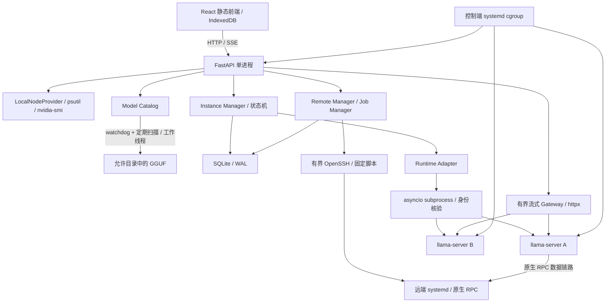

# V2 实现架构

## 边界

Node、Model、Instance 和 ChatSession 是独立实体。Node provider 和 Runtime adapter 使用注册表；当前支持本地节点、SSH RPC 节点和 llama.cpp。前端只提交 Model ID 和 Instance ID，不提交任意文件路径、上游 URL 或命令行。

配置与运行态分别保存在实例的 `config` 和 `runtime` 中。UUID 标识实例；PID 只是可变运行信息。API 不暴露内部 endpoint、完整命令或绝对模型路径。

管理端不导入任何推理库。GGUF 解析器只读取必要元数据和张量目录，seek 跳过 tokenizer 数组及权重；校验文件长度覆盖所有张量，拒绝不完整文件及分片模型。元数据解析有计数、深度和字符串大小限制。

## 文件发现

启动即全量观察；连续稳定至少 1 秒后再解析和接纳。watchdog 事件唤醒扫描，忽略解析器自身引起的 open/read 通知；后台每 30 秒兜底扫描。扫描通过 `asyncio.to_thread` 执行并串行化；API 使用完成后的内存快照。正在复制 / 被修改的模型立即退出可用目录。错误按 fingerprint 缓存，文件改变后重试。

fingerprint 由设备号、inode、大小、mtime_ns 和 ctime_ns 构成，不对 GB 级权重全量计算哈希。Model ID 由节点、配置的规范化根路径和相对文件路径生成，文件内容替换不改变 ID；迁移根目录会生成新 ID。所有候选文件 resolve 后必须仍在其允许根目录内。

## 生命周期

`created → starting → ready → stopping → stopped`，启动 / 运行异常进入 `failed`；failed 可再次销毁到 stopped，不在原实例上自动重启。创建和端口分配串行化，每实例生命周期使用单独异步锁，防止健康检查与销毁覆盖状态。操作系统端口外部争抢会使进程启动失败，保留错误和日志。

直接以参数数组启动，不使用 shell，不接受任意 extra_options。当前只允许 Flash Attention、mlock、no_mmap 三个布尔选项。屏蔽继承的 `LLAMA_ARG_*` 环境变量，避免外部环境改变监听地址或模型。CPU / GPU 等其余环境由现有运行环境提供。

日志直接写入 append 模式文件，避免为输出保留无界管道。监视器每次轮询时检查日志，超过默认 10 MiB 后保留最后至多 1 MiB；该截断是尽力而为的日志维护，瞬时日志量可超过阈值，截断窗口可能丢失部分诊断输出。日志 API 最多读取最后 32 KiB。

SQLite 持久化通过标准库 sqlite3 实现；所有数据库磁盘操作移到工作线程。为降低依赖和常驻开销，V1 没有引入 SQLAlchemy；仓储层封装便于后续迁移。数据库锁禁止同一数据库的多管理端进程。恢复必须同时满足 PID、创建时间、启动参数一致，不会向不匹配的进程发送信号。

## 网关与内存

共享一个不读取代理环境变量的 httpx 客户端，仅向已登记 READY 实例转发。SSE 按上游网络块直接转发，不拼接完整回答。独立断连监测可取消等待中的读取，取消屏蔽区保证关闭上游连接并释放并发计数。请求、响应、并发量和连接池都有上限；网络读取保持背压。

SQLite 保存全部历史实例；会话保存在浏览器，摘要和消息分表，仅加载所选会话。单会话请求最多 500 条消息、单条内容最多 500,000 字符，并受总请求 2 MiB 约束；界面默认只渲染最后 100 条。历史记录长期增长仍需按实际工作负载评估资源占用。

## 当前局限

无账户系统、自动 GPU 调度、Router Mode、模型下载 / 转换、跨机器同步或浏览器多标签协同生成。只接收文本 Chat Completions 子集（system/user/assistant、stream、temperature、top_p、max_tokens、stop）；多模态、工具调用不在 V1 范围。分片 GGUF 需要先在管理平台外合并。Windows 的源码链接可能需要系统开发者模式；可直接配置二进制路径避开链接。

## V2 集中式远端管理

RemoteManager、JobManager、DeploymentService、ResourceManager 运行于同一个后端事件循环；元数据和资源占用落到现有 SQLite。ManagerStore 增加 nodes/workers/jobs/credentials/claims，不引入数据库服务或 ORM。升级前自动备份，controller_id 保持稳定。

SshTransport 调用系统 OpenSSH，默认池上限 4、并行命令 2、等待队列 20。ControlMaster 以前台 -M -N 运行，不通过 -f 后台化；管理端登记并回收每个连接。密码由私有 Unix socket 和 SSH_ASKPASS 短时传递，首次登录写入专用公钥后转为密钥认证。主机密钥先独立核验，再执行固定参数化脚本；无远端任意命令接口。

远端短时 shell 脚本读取 Linux 基础信息，静态配置缓存 1 小时，动态资源默认 30 秒采样，失败按节点退避。HTTP 返回缓存快照，不为浏览器轮询发起 SSH。Jetson 的共享 RAM 与独立显存分开，未知值保持 null，计算就绪只由 RPC / 推理验证产生。

发布包先在控制端流式校验归档和文件摘要，再由原生 SFTP 上传；远端解压到暂存目录、检查动态库、按发布 ID 与归档摘要保存不可变版本，最后切换启动脚本和 systemd 用户服务。单元、runner 和二进制摘要均核验；失败保留旧版本配置供手动恢复启动。不同升级不覆盖旧二进制。只操作 controller_id/worker_id 所属目录和明确验证接管的服务。

创建多机实例先在一个 SQLite 事务中预留所有 worker，再后台准备 RPC，明确构造 --rpc、--device、--tensor-split 和 layer split。以完整 worker 为独占单位；不在使用中的原生 RPC 上建立探测连接，避免占用单客户端服务。实例退出后，通过所属进程状态和新协议握手核对旧会话已清理；无法确认则保留 quarantined 占用，核对前不可复用。

## V2 退出与恢复

默认启动器创建 systemd 用户服务，ExitType=main、KillMode=control-group、TimeoutStopSec=10、SendSIGKILL=yes、Restart=no。所有受管 llama-server 保留在相同 cgroup，即便 setsid 也不能跨后端退出存活。正常关闭主动销毁实例；后端异常退出 / SIGKILL 时操作系统终止全部受管子进程。启动包装进程和 SSH 也计入管理内存。

远端 RPC 独立由远端 systemd 管理，管理端退出时保持待命；原生 RPC 检测到数据连接断开后释放该会话资源。SSH 断连本身不等于 RPC 断连，不终止正常推理。后端重启将旧活动实例标为 failed，核对占用，保留历史但不重载模型。突然掉电 / 全链路断网后的限时回收不在本版范围。

`--direct` 只用于隔离测试，不具备上述 SIGKILL 兜底保证。真实多 GPU、目标平台兼容性和具体内存数据以 validation_v2.md 的已验证范围为准。
