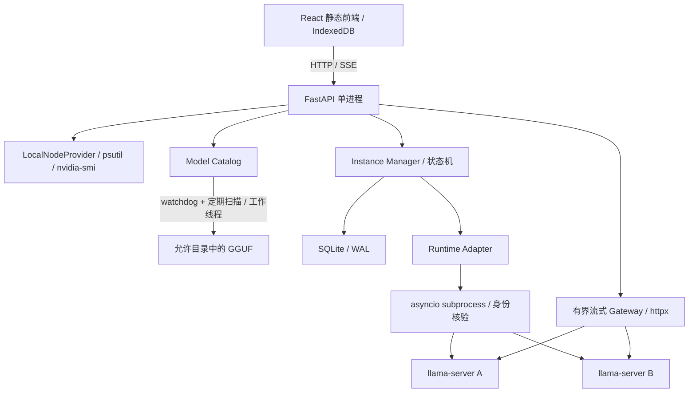

# V1 实现架构

## 边界

Node、Model、Instance 和 ChatSession 是独立实体。Node provider 和 Runtime adapter 使用注册表；当前仅注册本机节点和 llama.cpp，后续可增加 provider / adapter。前端只提交 Model ID 和 Instance ID，不提交任意文件路径、上游 URL 或命令行。

配置与运行态分别保存在实例的 `config` 和 `runtime` 中。UUID 标识实例；PID 只是可变运行信息。API 不暴露内部 endpoint、完整命令或绝对模型路径。

管理端不导入任何推理库。GGUF 解析器只读取必要元数据和张量目录，seek 跳过 tokenizer 数组及权重；校验文件长度覆盖所有张量，拒绝不完整文件及分片模型。元数据解析有计数、深度和字符串大小限制。

## 文件发现

启动即全量观察；连续稳定至少 1 秒后再解析和接纳。watchdog 事件唤醒扫描，忽略解析器自身引起的 open/read 通知；后台每 30 秒兜底扫描。扫描通过 `asyncio.to_thread` 执行并串行化；API 使用完成后的内存快照。正在复制 / 被修改的模型立即退出可用目录。错误按 fingerprint 缓存，文件改变后重试。

fingerprint 由设备号、inode、大小、mtime_ns 和 ctime_ns 构成，不对 GB 级权重全量计算哈希。Model ID 由节点、配置的规范化根路径和相对文件路径生成，文件内容替换不改变 ID；迁移根目录会生成新 ID。所有候选文件 resolve 后必须仍在其允许根目录内。

## 生命周期

`created → starting → ready → stopping → stopped`，启动 / 运行异常进入 `failed`；failed 可再次销毁到 stopped，不在 V1 原实例上重启。创建和端口分配串行化，每实例生命周期使用单独异步锁，防止健康检查与销毁覆盖状态。操作系统端口外部争抢会使进程启动失败，保留错误和日志。

直接以参数数组启动，不使用 shell，不接受任意 extra_options。当前只允许 Flash Attention、mlock、no_mmap 三个布尔选项。屏蔽继承的 `LLAMA_ARG_*` 环境变量，避免外部环境改变监听地址或模型。CPU / GPU 等其余环境由现有运行环境提供。

日志直接写入 append 模式文件，推理进程可以跨管理端重启继续输出。监视器每次轮询时检查日志，超过默认 10 MiB 后保留最后至多 1 MiB；该截断是尽力而为的日志维护，瞬时日志量可超过阈值，截断窗口可能丢失部分诊断输出。日志 API 最多读取最后 32 KiB。

SQLite 持久化通过标准库 sqlite3 实现；所有数据库磁盘操作移到工作线程。为降低依赖和常驻开销，V1 没有引入 SQLAlchemy；仓储层封装便于后续迁移。数据库锁禁止同一数据库的多管理端进程。恢复必须同时满足 PID、创建时间、启动参数一致，不会向不匹配的进程发送信号。

## 网关与内存

共享一个不读取代理环境变量的 httpx 客户端，仅向已登记 READY 实例转发。SSE 按上游网络块直接转发，不拼接完整回答。独立断连监测可取消等待中的读取，取消屏蔽区保证关闭上游连接并释放并发计数。请求、响应、并发量和连接池都有上限；网络读取保持背压。

SQLite 保存全部历史实例；会话保存在浏览器，摘要和消息分表，仅加载所选会话。单会话请求最多 500 条消息、单条内容最多 500,000 字符，并受总请求 2 MiB 约束；界面默认只渲染最后 100 条。历史记录长期增长仍需按实际工作负载评估资源占用。

## V1 局限

无认证、远程节点、自动 GPU 调度、Router Mode、模型下载 / 转换、跨机器同步或浏览器多标签协同生成。只接收文本 Chat Completions 子集（system/user/assistant、stream、temperature、top_p、max_tokens、stop）；多模态、工具调用不在 V1 范围。分片 GGUF 需要先在管理平台外合并。Windows 的源码链接可能需要系统开发者模式；可直接配置二进制路径避开链接。
