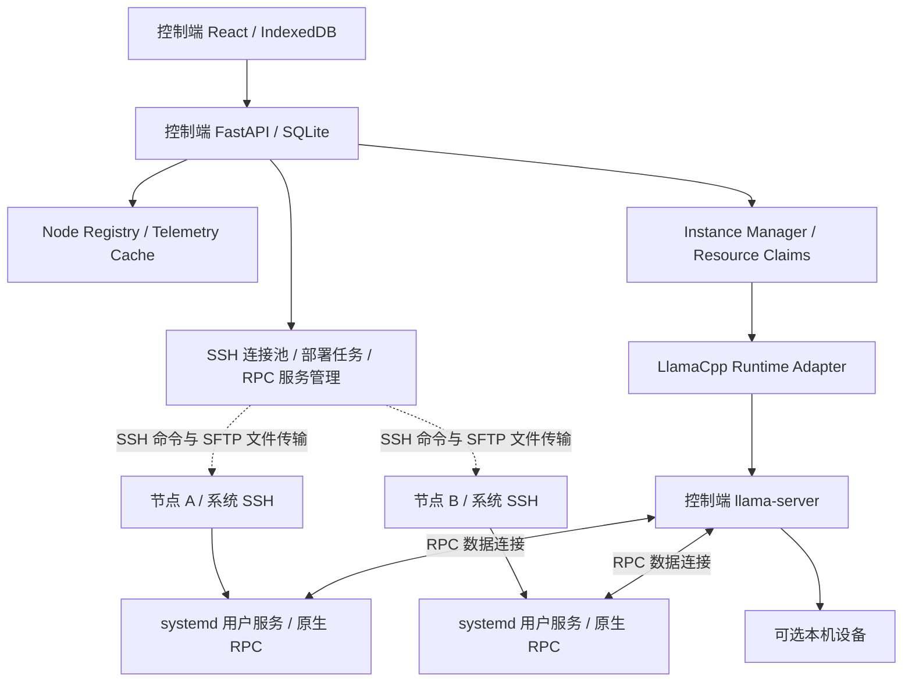

# llama.cpp Inference Manager：V2 开发设计文档

- 版本：V2.0 / 设计稿第二次修订。
- 日期：2026-11-20（Asia/Shanghai）。
- 本次修订：管理后端退出 / 崩溃时终止全部受管 llama-server，远端 RPC 保持待命并在确认断连后释放实例资源；断电、断网自动回收延后。
- 阶段：M1～M4 核心功能已实现并完成隔离联调；M5 已有崩溃清理与压力验证，真实三机 GPU 验收仍待完成。逐项证据和内存结果见 [V2 验证记录](validation_v2.md)，本文保留设计要求，不将设计目标视为验收结果。
- V1 基线：[`1188540`](https://github.com/zEeZ-1/LLAMA-MANAGER/commit/11885402670ad3bf9a6b55f4c9f82f05d6c72081)，已独立提交并推送。
- 延续 [V1 开发设计](development_v1.md)、[现有架构](architecture.md)及[验收记录](validation_v1.md)。冲突时，V2 新增的多机与节点显示规则以本文为准，单机与 Chat 基础能力继续兼容 V1。

## 1. 目标与使用边界

V2 实现一个控制主机管理多台 RPC 计算节点。远端日常只需插电开机、接入网络；用户在控制端添加 IP，通过 SSH 完成连接、机器信息读取、RPC 自动部署及启停，随后选择多个节点共同运行一个模型。

只有控制主机运行本项目的 FastAPI、SQLite 和静态前端。远端不安装本项目管理后端、前端、数据库、消息队列或常驻 Python / Node Agent；使用已有系统 SSH 和原生 `ggml-rpc-server`。采集、部署脚本按需执行，执行后退出，不形成额外守护进程。

### 1.1 “插电开机”的前提

远端需要事先具备可启动的 Linux 系统、可达网络、已启用的 SSH 服务及可登录账户。GPU 节点还需正确安装 GPU 驱动及兼容运行库。IP 本身不能代替账户认证，也不能在 SSH 尚未启用时远程安装 SSH。

首次接入提供 SSH 用户名及密钥，或一次性登录密码；后续记住节点与凭据引用，复用密钥连接。涉及首次启用用户服务 linger 的操作需要相应权限，必须检测并明确报告，不能假设普通 SSH 登录天然具有管理员权限。

主机未开机、无网络或 SSH 被禁用时，显示具体原因。远程刷系统、装驱动、改防火墙和 Wake-on-LAN 不属于 V2。控制主机突然掉电、网络分区及全链路断网后的远端限时回收和自动恢复留待后续版本；V2 不增加相关心跳租约、远端 watchdog 或强制清理机制。

### 1.2 资源目标

- 控制端继续以管理后端、SSH 管理子进程和一个专用工作台浏览器合计 RSS 小于 **1 GiB** 为验收目标。
- 新增 SSH / 节点管理功能相对同等 V1 基线的增量 RSS，目标不超过 **100 MiB**。这是设计预算，尚未实测。
- RPC 进程本身、GPU 运行环境、模型权重、计算缓冲、KV cache 和磁盘缓存单独统计，不以“远端无 Agent”暗示它们没有开销。
- 首版目标规模为 3 台实际机器，支持最多 10 个登记节点；不引入自动调度与分布式控制平面。

## 2. V2 功能范围

| 功能 | V2 约定 |
| --- | --- |
| 手动添加节点 IP | 实现，首版使用 IPv4 地址，不接受任意 URL 或 Shell 表达式 |
| SSH 登录 | 复用现有密钥；支持一次性密码引导转为专用密钥 |
| 主机身份核验 | 显示首次指纹并保存信任记录，指纹变化阻断连接 |
| 静态配置 / 动态状态 | 自动读取，按来源和有效期分别缓存 |
| 自动部署 RPC | 检测环境，分发匹配的预编译包，校验后安装 |
| RPC 启动 / 停止 / 日志 | SSH 操作本平台管理的 systemd 用户服务 |
| 退出 SSH 后继续运行 | RPC 和现有推理不受单纯 SSH 断开影响；核验 user manager 和 linger |
| 管理后端正常退出 / 崩溃 | 终止全部受管 llama-server；远端 RPC 保持待命，确认断连后释放实例资源 |
| 管理后端重新启动 | 核对旧实例终止和资源释放状态，不保留或自动重启旧 llama-server |
| RPC 随开机启动 | 可选，默认关闭；远端开机后仍可从页面手动启动 |
| 已有 RPC | 检测、导入；显式关联和验证后才允许管理启停 |
| 多节点单模型实例 | 控制主机运行 llama-server，选定本机 / 远端设备参与 |
| 设备顺序 / 分配比例 | 用户显式选择，后端生成合法命令参数 |
| Worker 占用管理 | 一个 RPC worker 同时仅被一个实例独占 |
| 节点信息显示修正 | 本机和远端统一；支持 Jetson 共享内存及指标缺失 |
| 单机模式与原有 Chat | 保持兼容 |
| 自动局域网扫描 / 自动调度 | 不实现 |
| 远端独立 llama-server / HTTP 网关 | 不实现，llama-server 均在控制主机 |
| Windows / macOS 远端部署 | 不纳入首版验收，保留平台适配接口 |
| 运行中增减节点 / KV 热迁移 | 不实现，调整参与节点需重建实例 |
| 多控制端并发管理同一 worker | 不支持 |
| 突然掉电 / 全链路断网后的限时回收 | 后续版本处理，不作为 V2 功能或验收承诺 |

首轮部署验收以现有 Linux aarch64 / Jetson Orin 为主；Linux x86_64 / CUDA 只有在提供并验证对应包后才能显示为支持。不能把“SSH 可登录”当成“任意平台可自动部署”。

## 3. 系统架构与职责



SSH 承担管理与遥测，RPC 承担推理设备操作，两条链路的可用状态独立。普通 SSH 连接中断不能直接判定正在推理的 RPC 连接也已失效。

模型目录仍集中在控制主机。远端无需完整 GGUF 文件；运行时传送所需张量，可在远端配置 RPC 磁盘缓存。该缓存有磁盘开销，不能保证每次启动都不传输权重。

一个 Instance 仍对应控制主机上的一个独立 llama-server，可使用多个 RPC worker 和可选本机 GPU。远端不是完整推理 HTTP 服务，不提供 Chat 接口、分词和会话存储。

## 4. 用户流程

### 4.1 首次添加节点

1. 输入节点名称、IP、SSH 端口（默认 22）、用户名和认证方式。
2. 获取并显示 SSH 主机指纹。首次信任需要用户核对，不能通过 `StrictHostKeyChecking=no` 静默跳过。
3. 完成登录后读取主机身份、OS、CPU、RAM、GPU、驱动、运行库和 systemd 能力。
4. 展示检测结果：已支持、缺少运行库、需要部署、权限不足或未知平台。
5. 为支持的平台安装 RPC：传输匹配包、校验、配置服务，后台任务显示真实步骤和错误。
6. 检查 RPC 的服务身份、版本及空闲时的协议响应，节点进入可选择状态。
7. 用户可从节点卡片启动 / 停止 RPC，在实例表单选择该节点。

“连接并准备节点”是用户发起的完整接入动作，授权其必要的专用公钥安装、平台所属目录写入和 RPC 服务配置；不授权修改现有无关服务或系统级安全策略。

### 4.2 后续开机接入

控制端保留节点 ID、IP、账户、信任指纹和凭据引用。远端重启后恢复 SSH，平台重新采集状态；RPC 未启动时显示“已停止”，提供启动操作，不要求用户到远端打开终端。

IP 改变后允许编辑地址，但必须重新核验主机指纹及已登记身份。机器重装、更换主机或指纹变化不能自动视为同一节点。

### 4.3 已有服务的处理

发现端口或服务已经存在时先只读检查。属于当前控制端且清单匹配时可恢复管理；外部部署需用户在接入流程中显式选择关联已有服务，并通过二进制、版本、用户、监听地址及服务路径核验。

不自动停止、覆盖、升级或卸载现有 `llama-*` 服务，不使用进程名模糊匹配或 `pkill`。无法确认身份的已有进程标记“外部服务 / 未接管”，禁止发送停止信号。

### 4.4 节点日常操作

- 查看详情：展示硬件、系统、GPU、网络地址、SSH、RPC、部署版本和最新采样时间。
- 启动 RPC：服务已运行时幂等返回；版本不匹配、权限不足和端口冲突分别报错。
- 停止 RPC：有活动资源占用时返回冲突和实例列表。先销毁相关实例，再停止；V2 不提供绕过占用检查的普通按钮。
- 更新 RPC：空闲时才允许，失败保留旧版本；不自动更新使用中的节点。
- 移除节点：停止、失败和历史引用仍须核查；有活动 / 待确认占用时拒绝移除，允许归档空闲节点。移除登记默认不卸载文件、删除缓存或撤销既有账户。
- 清理缓存：仅在 RPC 停止且无占用时对平台所属缓存目录执行，不删除系统目录或其他项目缓存。

## 5. 数据实体与身份

### 5.1 Node 与 Device

```typescript
interface Node {
  id: string;                         // UUID；local 为 V1 本机 ID
  role: 'controller' | 'rpc_worker';
  name: string;
  address: string | null;
  identity: { machine_id_hash: string | null; ssh_host_key_fingerprint: string | null };
  ssh: { port: number; username: string; credential_id: string | null } | null;
  connection_state: 'unknown' | 'connecting' | 'online' | 'offline' | 'auth_failed' | 'host_key_changed';
  inventory: NodeInventory;           // 静态配置及数据来源
  telemetry: NodeTelemetry;           // 动态指标及有效时间
  rpc_worker_ids: string[];
  archived_at: string | null;
  created_at: string;
  updated_at: string;
}

interface Device {
  id: string;                         // 节点 + 后端 + 稳定设备标识，必要时回退索引
  node_id: string;
  name: string;                       // 面向用户的硬件名称
  backend: 'cuda' | 'cpu' | 'unknown';
  driver: string | null;              // 例如 nvgpu，单独展示
  physical_id: string | null;
  backend_index: number | null;
  memory_kind: 'dedicated' | 'shared' | 'unknown';
  compute_state: 'unverified' | 'ready' | 'error';
  last_compute_check_at: string | null;
}
```

`machine_id` 只用于变化检测，保存其散列，不作为全局绝对唯一性的保证。克隆系统可能有相同 machine-id，因此结合节点 UUID、SSH 指纹和用户操作核验。设备索引变化需重新枚举和校验，不能继续套用旧实例的设备映射。

### 5.2 指标统一结构

```typescript
interface Metric<T> {
  value: T | null;
  unit: 'bytes' | 'percent' | 'MHz' | 'count' | 'text';
  status: 'ok' | 'unsupported' | 'permission_denied' | 'error' | 'unknown';
  source: string | null;
  sampled_at: string | null;
  stale: boolean;
  reason: string | null;
}
```

内存指标统一用 bytes，比例用 0～100 的 percent。`value: 0` 与 `value: null` 不同；缺失不能转换为 0。过期和不支持分开表示，保留最近一次有效值时必须标注时间和 stale。

`NodeInventory` 包含硬件型号、OS / 内核、架构、CPU 型号和核心数、RAM 总量、GPU 列表、驱动 / CUDA / JetPack 或 L4T 版本、systemd / linger 能力。

`NodeTelemetry` 包含 CPU 使用率、RAM total / available / used、swap、GPU 使用率和频率（支持时）、独立显存（存在时）、RPC 进程 RSS，以及采样来源与时间。RPC 模型 buffer、进程 RSS、cgroup memory 和文件缓存是不同口径，不能相互冒充。

### 5.3 RpcWorker

```typescript
interface RpcWorker {
  id: string;
  node_id: string;
  device_ids: string[];
  endpoint: { host: string; port: number };
  management_mode: 'managed' | 'observed';
  controller_id: string | null;
  service_name: string | null;
  release_id: string | null;
  runtime_commit: string | null;
  package_sha256: string | null;
  protocol_version: string | null;
  state: 'uninstalled' | 'deploying' | 'stopped' | 'starting' | 'ready' | 'stopping' | 'failed' | 'unknown';
  process_identity: { pid: number; start_time: string; boot_id: string } | null;
  last_error: { code: string; message: string; occurred_at: string } | null;
}
```

首版每个远端登记一个 worker。一个 worker 可以暴露该机一个或多个选定设备，但占用以整个 worker 为粒度，因为一个 RPC 服务端口的控制连接不能作为多个独立实例的并发入口。

### 5.4 Instance 与 Placement

保留 V1 的 `node_id`，其含义是 llama-server 所在控制节点，V2 仍为 `local`；不能把它改成数组导致旧会话和 API 失效。新增：

```typescript
interface Placement {
  mode: 'local' | 'rpc';
  devices: Array<{
    device_id: string;
    worker_id: string | null;          // 本机设备为 null
    weight: number;                    // 显式正比例，不是精确显存 / 层数配额
  }>;
}
```

InstanceConfig 保存 placement，InstanceRuntimeInfo 保存启动时解析出的 endpoint、真实设备名、顺序、版本快照及资源占用记录。业务 ID 不使用 `RPC0`、IP 或 PID；RPC 枚举名只在启动时根据固定版本生成。

### 5.5 CredentialRef、Job 与 ResourceClaim

- CredentialRef：只包含类型、标签、受控密钥引用和所属账户；API 不返回私钥、密码或服务器本地任意文件路径。
- Job：连接、采集、部署、启停任务的持久化进度；保存步骤、有限错误和时间，不保存密码。长操作返回 job ID。
- ResourceClaim：worker、Instance ID、状态、controller ID、创建时间和解除时间；worker 上的活动占用具有数据库唯一约束。
- 占用状态：`reserved → active → releasing → released`；无法确认远端释放时进入 `quarantined`，仍阻止重新分配。

## 6. SSH 连接与凭据管理

### 6.1 Transport 接口

```python
class SshTransport:
    async def inspect_identity(self, node): ...
    async def execute(self, node, operation, arguments, timeout): ...
    async def upload(self, node, source, target, expected_hash): ...
    async def close_idle_connections(self): ...
```

首选复用控制主机的 OpenSSH / SFTP，通过异步子进程管理，使用 ControlMaster 和有限 ControlPersist。凭据、连接池、主机信任记录均留在控制端。

首次密码认证使用本机短时凭据桥接与 `SSH_ASKPASS`，通过受控 IPC 从内存读取密码；不用 `sshpass -p`，不将密码放入命令参数、环境变量、临时明文文件或日志。桥接只处理指定任务的认证提示，身份信任提示走独立流程。登录后为用户此次接入动作安装平台专用公钥，后续转为密钥认证；不静默回退为长期保存密码。

专用公钥幂等追加到该账户 authorized_keys，带控制端标记，保留所有已有条目。不授予管理员权限，不修改 sudoers。私钥存放在控制端受保护目录，目录 0700、文件 0600；支持由外部 SSH agent / 已有密钥引用替代。

### 6.2 连接与命令约束

- 所有连接核验登记的 host key。首次扫描得到的 key 只是候选，不能宣称已验证；主机密钥变化停止自动操作。
- 不启用 agent forwarding、任意端口转发或网页 Shell。
- 仅向登记节点及允许网段发送请求；IP、端口、用户名和内部路径分别校验，禁止从 API 传入整段 SSH 命令。
- 本地使用参数数组仍不等于远端没有 shell 解释。远端采用固定版本的短脚本、受控操作枚举和严格参数编码 / 引用，不拼接用户名称、路径或密码到 shell 片段。
- 同一节点命令串行，多个节点使用有界并发；超时取消并回收本地子进程，不能卡住 FastAPI 事件循环。
- 部署、查询、启停任务持有节点级操作锁；相同操作支持 idempotency key，重复点击不创建第二个 worker。
- 标准输出和错误分块读取并设总量限制，不对无限输出调用无界 communicate。日志中的认证信息必须脱敏。

### 6.3 SSH 生命周期

SSH 采用按需建立、短时复用、空闲关闭的方式，不要求永久长连，也不承担让模型持续运行的保活职责。SSH ControlMaster 到期或 SSH 单独断开时，只要管理后端与 RPC 推理链路正常，已加载模型保持运行。关闭网页不会停止推理实例。

远端 RPC 始终由其 systemd 用户服务托管。管理后端正常退出或崩溃时，按第 10.4 节终止全部受管 llama-server；远端 RPC 在检测到其推理连接结束后清理实例资源并继续待命，不随 SSH 连接结束而退出。

连接失败区分网络超时、拒绝连接、认证失败、host key 变化和命令权限不足。后台定时采集失败保留最近快照并标注过期，不把全部字段清零。

## 7. 环境检测与 RPC 自动部署

### 7.1 支持的环境和发布清单

每个可部署包至少包含：release ID、llama.cpp commit、RPC 协议版本、CPU 架构、目标 OS / glibc 兼容范围、GPU 后端、GPU 架构、CUDA 运行库要求、构建特性、文件清单、SHA256 和第三方许可证。

控制端与 worker 默认要求相同的经过验证的上游 commit / 协议适配器。二进制可以针对不同机器构建，但协议兼容不能仅凭程序文件名判断。V1 固定 commit 为 `9214bdb554544c35e4a9e2c2e8b75d8cfee330ab`；V2 初始优先沿用，后续升级需同步验收，不能跟随 master 自动更新。

Jetson 的 JetPack / L4T、CUDA、glibc 与 GPU 架构分别检测，不能仅看到 aarch64 就上传本机二进制。兼容包缺失时显示“不支持当前环境 / 缺少匹配包”，不自动在远端编译，不下载完整模型库，也不自动安装驱动或 CUDA Toolkit。

### 7.2 部署步骤

1. 检测 SSH、账户写权限、systemd 用户管理器、linger、必要工具和剩余磁盘空间。
2. 检查已有部署、目标目录、端口和服务归属；存在非平台所属服务时停止自动覆盖。
3. 从控制端受控发布目录选择匹配包，以流式传输写入远端临时文件；不在 Python 内存中整体解压压缩包。
4. 核对 SHA256；安全解压，拒绝绝对路径、`..` 路径穿越及逃出发布目录的链接。
5. 进行动态库及可执行文件预检查，记录实际版本、权限与后端支持。
6. 写入版本目录、受控启动参数和 systemd 用户单元，保存所属 controller / worker 清单。
7. 通过同一文件系统内的重命名或受控 current 链接切换版本，reload 用户单元。
8. 按用户接入动作启动或保持停止；在空闲时做 RPC 协议和设备核验，完成后才标记就绪。

步骤可重试，成功步骤需核验后复用；连接中断后先读取实际部署状态再决定重试。中断任务恢复为“待核对”，不能直接宣称失败并重复覆盖。已有可用版本在切换前保留，失败可回退。

### 7.3 systemd 用户服务

新建服务使用平台专属名称，例如 `llama-manager-rpc-<worker-short-id>.service`，不覆盖现有 `llama-rpc-worker.service`。程序以登录的普通用户运行，监听明确的 LAN 地址和端口，设备、缓存目录及日志路径来自经过校验的部署配置。

应检查 `loginctl show-user` 的 linger 状态，保证退出 SSH 后用户服务可持续运行。未启用且需要提权时，任务显示 `privilege_required`；可由用户在首次准备步骤提供相应授权，或由远端管理员预先启用。管理员操作限于必要的用户服务持续运行设置，不自动授予免密 sudo。

服务随开机启动开关默认关闭。即使不开机自动启动 RPC，也应保证远端开机后可以通过 SSH 直接执行用户服务启动，不需要本地交互登录。

### 7.4 升级、日志与缓存

- 活动实例、reserved 或 quarantined 占用存在时禁止升级和重启 worker。
- 日志通过按需 journal 查询获取，单次最多 64 KiB，不常驻 `journalctl -f`。
- RPC 缓存是磁盘缓存，默认可启用；展示目录所属和大小、磁盘余量，低空间时明确告警。
- V2 不假设上游 RPC 缓存自带容量上限。平台只在服务停止且空闲时清理自己的缓存，不能在推理中删除缓存或任意执行全盘清理。

## 8. 节点信息采集与显示规范

### 8.1 本机与远端使用同一显示模型

LocalNodeProvider 与 SshNodeProvider 输出同一 NodeInventory / NodeTelemetry 结构。页面只按字段含义、source 和 status 渲染，不针对“本机 / 远端”硬编码两套缺失值逻辑。

静态信息优先读取 `/etc/os-release`、`/proc`、设备树、CPU 拓扑及已安装工具。远端不得为采集信息安装 psutil、PyTorch、Transformers、jtop 后台服务或 Node；如使用诊断脚本，其应为短时执行的系统命令脚本。

CPU 型号与指令架构分开。不能把 `aarch64` 当作 CPU 型号；无法识别具体型号时显示“型号未提供”，仍单独展示架构和可确认的逻辑核心数。

Linux CPU 使用率使用相邻 `/proc/stat` 快照的差分计算，第一次缺少基线时标记尚未采集，不伪造 0%。内存使用量与 available 的定义在 API 中固定，避免把系统缓存和应用常驻内存混成同一指标。

### 8.2 GPU 计算能力与监控指标分离

以下三种状态必须分开：

| 状态 | 判断依据 | 显示方式 |
| --- | --- | --- |
| GPU 已识别 | 设备树、驱动、系统枚举等 | 展示硬件名称及驱动，不承诺已完成计算验证 |
| 计算能力已验证 | 匹配版本的 runtime 后端及设备检查通过 | 显示“计算就绪”及验证时间 |
| 监控指标未提供 | 某项查询返回 N/A、工具缺失或权限不足 | 仅对应指标显示原因，不将整张 GPU 标红 |

`nvgpu` 是驱动标识，不是错误状态。GPU 名称优先显示“NVIDIA Orin · 集成 GPU”或检测到的具体型号；`nvgpu` 放在详情中的驱动字段。

禁止用以下条件判定 GPU 不可用：memory_total 为 null、nvidia-smi 使用率为 N/A、CUDA Toolkit 没有 nvcc、当前 GPU 使用率为 0。

计算检查失败、驱动错误或后端不支持时，应展示有证据的具体错误。未经检查显示“计算能力待验证”，不能显示“计算就绪”。

### 8.3 独立显存与共享内存

| 情况 | 节点卡片 GPU 行 | 详情说明 |
| --- | --- | --- |
| Jetson Orin / 已确认共享内存 | `共享系统内存` | 展示系统 RAM 总量、可用量及 GPU 指标来源 |
| 独立显存，指标正常 | `显存 12.0 / 24.0 GiB 可用` | GPU 专用显存与系统 RAM 分开展示 |
| GPU 已识别，但内存类型未确认 / 字段缺失 | `显存指标未提供` | 显示 source、status、原因和时间 |
| 指标读取无权限 | `显存读取权限不足` | 不改变设备计算状态 |
| 最近采集失败 | 最近有效值 + `数据已过期` | 显示最后成功时间和采集错误 |

不能仅因为显存字段为 N/A 就推断它一定是共享内存。Jetson 由平台身份、设备树和采集能力共同确认；无法确认时使用 unknown。

共享内存设备的 RAM 不能再当成一份独立显存叠加到“节点总容量”。系统 MemAvailable 也不是保证可分配的 CUDA 内存上限，不可据此承诺模型一定能加载。

### 8.4 Jetson 采集

- RAM、available、swap 从系统内存接口读取；清楚区分物理总量与当前可用量。
- GPU 利用率 / 频率优先使用可读 sysfs 节点；次选受超时控制的单次 tegrastats 采样。
- tegrastats 只捕获一次有效样本，随后终止并回收；不运行无界后台采集，也不执行全局 `tegrastats --stop` 影响其他使用者。
- L4T / JetPack / 驱动与 CUDA 运行库分开展示；版本取不到时保留 null 和原因。
- nvidia-smi 的 `[N/A]`、`Not Supported` 等映射为指标 unsupported，不转换为 0。
- tegrastats 的 RAM、GPU 使用率和 nvmap / 进程内存口径不可相互替代；未实现可靠进程 GPU 内存统计时明确标注未提供。

### 8.5 页面内容

节点卡片展示：节点名称、硬件型号 / hostname、地址、连接状态、CPU 型号和核心数、系统 RAM、GPU / 内存类型、RPC 状态、活动实例数、最近更新时间。

本机展示本地模型数量；RPC worker 显示“模型由控制主机提供”，不将控制端模型数量复制成远端本地模型数量，也不扫描远端模型目录。

详情页分为硬件与系统、实时资源、SSH 连接、RPC 部署及服务、关联实例、日志。GPU 计算状态、SSH 状态、RPC 状态、占用状态分别显示，不用一个 online 字段掩盖差异。

缺失值采用“未提供 / 不支持该指标 / 权限不足 / 尚未采集 / 数据已过期”等明确文案，所有关键指标显示采样时间。禁止再出现没有字段说明的裸“不可用”。

## 9. RPC 发现、兼容与健康检查

当前固定版本的 RPC 服务在 accept 后同步处理该控制连接，再接受下一个控制连接。因此首版不能把同一个 RPC endpoint 当作可供多个 llama-server 并发共享的公共池。协议能力升级后再单独评估共享，不在 V2 静默假定支持。

健康检查分层：

1. SSH 连接可用：能够认证并执行受控命令。
2. 服务身份正确：systemd 单元、发布清单、运行用户、PID / 启动时间 / boot ID 和监听配置匹配。
3. 协议可用：worker 空闲时完成固定版本的 HELLO / 设备数量检查。
4. 实例可推理：控制主机 llama-server 加载完成且 `/health` 通过。

TCP 端口能连接不等于 RPC 协议就绪，也不等于 CUDA 后端已验证。初始化服务失败不能被已有监听端口的其他进程掩盖。

RPC 探针采用与固定上游提交绑定的轻量协议适配器，只执行必要的只读握手与设备检查，设包长、设备数量和读取超时上限；不将 CUDA / 推理动态库导入管理后端。协议私有结构有版本风险，变更上游提交时必须同步更新适配与回归测试。

worker 有 reserved / active 占用时禁止新建 RPC 探针或独立 `--list-devices` 客户端。此时通过 SSH、systemd、有限日志及所属 llama-server 的健康状态判断，保留最近设备枚举快照，不将无法插入第二条控制连接判为离线。

worker 状态和占用状态分开。空闲 ready 代表最近一次服务 / 协议核验通过；开始创建实例前还需检查最新状态和版本，不能使用过期快照作资源保证。

## 10. 多机实例创建与资源分配

### 10.1 页面与配置

创建表单增加“单机 / 多机 RPC”模式。多机模式选择：

- 控制端上的模型。
- 一个或多个已登记、兼容、空闲的远端 RPC worker 设备。
- 是否使用本机 GPU，以及具体本机设备。
- 参与设备的顺序和每个设备的正分配权重。
- context、parallel、batch、ubatch、线程、KV 类型和 GPU layers。

单机参数与 V1 默认保持兼容。多机 GPU 模式不能沿用 V1 的 `n_gpu_layers=0` 却宣称已使用远端 GPU，应要求 GPU layers 大于 0，或由明确的多机表单默认值生成。

分配权重表达运行时 tensor split 比例，不是精确层数或显存硬限额。不可将 2:1:1 显示成承诺的层数或 50% / 25% / 25% 实际内存占用。

关闭“使用本机 GPU”只排除本机 GPU，不表示控制主机没有 CPU、RAM、模型文件映射或采样开销。V2 不承诺将全部推理内存从控制主机移走。

### 10.2 原子占用与启动顺序

```text
校验模型、节点、版本、设备及参数
    → SQLite 事务原子预留全部 worker
    → 持有节点 / worker 操作锁并复核服务身份
    → 按登记的部署配置准备 RPC
    → 解析本次启动的 endpoint 和真实设备映射
    → 启动控制端 llama-server
    → 等待模型加载及 /health
    → Instance READY，claims active
```

一个实例选择同一 worker 的多个设备，只创建一个 worker claim。两个并发创建请求争抢同一 worker 时只能一个预留成功；失败请求返回 409 和占用实例信息，不能启动两个进程后再靠报错仲裁。

RPC 服务的启动、停止、升级与实例预留共享同一事务 / 锁约束，杜绝“刚检查空闲便被另一个请求分配”的竞态。远程网络操作在事务外执行，避免长时间锁住 SQLite；使用 claim token 复核操作归属。

### 10.3 命令生成

扩展 LlamaCppAdapter，按已解析 placement 构造 `--rpc`、`--device`、`--split-mode layer`、`--tensor-split` 等参数。仍以本地参数数组启动，推理 HTTP 监听 127.0.0.1，由原网关访问。

- `--rpc` 在设备选择参数之前生效，按固定版本实际参数解析规则验证。
- 远端 endpoint 去重，设备顺序与 split 权重一一对应。
- 业务层保存 Device ID；真实 RPC 枚举名由已验证映射产生，不能永远假设某台机器就是 RPC0。
- 明确列出所选本机和远端设备，避免运行时默认把未选中的本机 GPU 加入。
- 校验当前构建启用 RPC 和要求的 GPU 后端；缺失能力直接报错，不悄悄退回 CPU。
- V2 暂以按层拆分为验收路径，不同时开发 row / tensor 分片或自动平衡算法。

分布式启动超时独立配置，建议默认 900 秒，单机仍可使用 V1 的 180 秒。首次权重传输、链路带宽和缓存状态会影响加载时间，页面展示“准备 worker / 传输与加载 / 等待健康检查”等实际阶段，不伪造精确进度。

### 10.4 失败、销毁与管理后端退出

本节替代 V1“关闭管理后端后保留 llama-server 并在重启后接管”的进程生命周期策略。所有停止操作只针对本平台登记且身份匹配的实例，不扫描或停止用户在平台外运行的同名进程。

#### 10.4.1 连接与退出处理表

| 情况 | 控制端 llama-server | 远端 RPC 服务 | 模型与会话 |
| --- | --- | --- | --- |
| 关闭网页 | 继续运行 | 继续运行 | 模型保持加载；会话历史保留 |
| SSH 单独断开 / 空闲连接关闭 | 继续运行，前提是 RPC 推理链路正常 | 继续运行 | 不因 SSH 断开卸载模型，遥测可标记过期 |
| 管理后端正常退出 / 重启 | 全部受管实例终止 | 保持待命 | 远端确认断连后释放模型、KV 等实例资源；不自动重载 |
| 管理后端崩溃 / 被 SIGKILL | 由 systemd 清理全部受管实例 | 保持待命 | 不依赖管理后端发送 SSH 清理命令；RPC 确认断连后释放实例资源 |
| 单个实例销毁 / llama-server 崩溃 | 对应实例终止，其他实例不受影响 | 保持待命 | 释放对应连接的实例资源；历史记录与会话保留 |
| 远端正常重启 | 受影响实例停止或标记失败 | 按已有启动配置恢复，未启用自启则保持停止 | 原内存模型丢失，后续创建实例时重新加载 |
| 控制主机突然掉电 / 网络彻底中断 | 后续版本定义完整处理策略 | 不承诺限时自动清理或重启 | V2 仅保留最后状态与待核对标记，不承诺掉电后立即释放 |

远端清理连接资源后，RPC 进程、CUDA 基础上下文和部分运行时缓存可能仍有占用；“释放模型”不等于 RPC 进程 RSS 必须归零。RPC 磁盘张量缓存保留，不属于仍然加载的模型；下一次创建实例可利用缓存，但必须重新建立实例和 KV 状态。

#### 10.4.2 崩溃清理必须由操作系统兜底

管理后端崩溃时无法保证执行 finally、lifespan shutdown 或 SSH 命令，因此不能仅用应用退出回调实现“全部 llama-server 终止”。Linux V2 的托管启动入口采用 systemd 用户服务，将管理主进程、其启动的全部 llama-server 及 SSH 管理子进程置于同一所属 cgroup。

关键服务策略如下，具体单元路径在实现阶段确定：

```ini
[Service]
Type=exec
ExitType=main
KillMode=control-group
TimeoutStopSec=10
SendSIGKILL=yes
Restart=no
```

管理主进程结束后，systemd 停用该服务并清理剩余所属进程，先终止、超时再强杀。正常退出时应用先停止接收新请求并尽力更新实例记录，操作系统仍负责最后清理。无需新增远端常驻清理程序。

llama-server 不能放进不受该服务退出约束的独立常驻单元或移出所属 cgroup；setsid 不能作为跨管理后端退出保留模型的手段。受支持的 V2 开发启动也应使用相同托管入口；缺少托管能力时明确提示，不能把普通裸 Python 启动宣称为通过 SIGKILL 清理验收。

systemd 管理器自身失效、控制主机掉电或不可中断的驱动故障不属于此清理时限保证。V2 验收覆盖正常停止、应用崩溃、SIGKILL 和可终止 / 需强杀的测试子进程，不承诺远端失联后的固定释放时间。

#### 10.4.3 实例状态与重新启动

- 显式销毁实例：拒绝新 Chat，确认本地 llama-server 退出，检查 worker 连接 / 资源释放后解除 claim。正常完成的记录设为 stopped，RPC 继续待命。
- 管理后端正常退出：终止全部受管 llama-server，尽力将实例记录写为 stopped；模型不跨管理后端重启保留。
- 管理后端崩溃：允许数据库暂留 starting / ready 等旧状态；下次启动先根据所属服务、PID / 创建时间和清理结果核对，把已退出的旧活动实例记为 failed，并记录 `manager_terminated`，不能继续显示就绪。
- 管理后端重新启动只恢复登记、历史和占用核对，不重新接管旧模型，不自动重建或启动旧实例。用户重新创建实例后才再次加载模型。
- 发现身份匹配的本平台遗留 llama-server 时先完成清理再开放创建；发现身份不匹配的同 PID 或外部进程时不得停止它，应报告身份变化。
- 历史实例和 IndexedDB 会话不删除；会话保留消息，用户可在新 READY 实例上继续。

#### 10.4.4 其余错误与当前边界

- 启动部分失败时仅停止本次实例并回收本次预留，不停止无关 worker 或外部服务。
- SSH 单独断开只使管理 / 遥测状态降级；不能把它作为终止仍正常推理实例的条件。
- 已检测到 RPC 服务退出、设备丢失或明确推理错误时，相关实例标记 failed、释放 HTTP 资源并停止本地对应进程；不自动替换节点或恢复原 KV。
- 无法确认远端释放时 claim 保持 quarantined，阻止重新分配；管理后端重新启动后通过 SSH 及空闲检查核对。不能只因时间到期就释放占用，也不强制重启未知状态的 worker。
- 断电、网络分区、静默断网的失联检测期限、自动卸载、远端心跳与重连续跑后续再设计。V2 不修改 RPC 上游源码或整机 TCP 参数以提供此类能力，也不承诺现有原生 RPC 会在这些情况下立即清理。

## 11. Backend 模块规划

在模块化单体内扩展，不引入 Celery、Redis、Kubernetes 或独立管理服务。

```text
backend/app/
  services/
    node_registry.py           # 登记、归档、节点身份和关联
    node_manager.py            # 统一节点读取接口
    telemetry_service.py       # 静态 / 动态采集、缓存、过期策略
    rpc_manager.py             # 所属服务启停和健康核验
    deployment_service.py      # 包选择、传输、校验、切换和回退
    resource_manager.py        # worker 原子占用及隔离恢复
    job_manager.py             # 有界任务、步骤和重启核对
    instance_manager.py        # placement 生命周期及管理后端退出收尾
  nodes/
    base.py
    local.py
    ssh.py
    collectors/
      linux.py
      nvidia.py
      jetson.py
  remote/
    ssh_transport.py
    credential_store.py
    host_keys.py
    scripts/                   # 版本化短时远端脚本；不含秘密
  runtime/
    base.py
    llama_cpp.py
    rpc_probe.py               # 与验证 commit 绑定的协议适配
  repositories/
    nodes.py
    workers.py
    claims.py
    jobs.py
    instances.py
```

发布包与控制端私有状态分开：

```text
inference_backends/rpc_packages/<release-id>/   # 受控二进制及 manifest，本机准备，不提交二进制
config/rpc_releases.example.yaml              # 可提交的环境匹配示例，不含凭据
config/rpc_releases.yaml                      # 本机配置，忽略
data/ssh/                                    # 专用私钥、known_hosts、ControlPath，忽略
data/database/                               # 原有 SQLite 和升级备份，忽略
data/logs/                                   # 有界管理日志，忽略
```

上面 data 路径与 V1 一样以项目根目录解析。实现时同时更新 `.gitignore`，确保私钥、主机信任记录、真实节点配置、压缩包、构建产物和数据库不进入仓库。

## 12. API 设计

继续使用 `/api/v1` 作为兼容 API 前缀；产品 V2 不等于所有 API 必须改成 `/api/v2`。以下为待实现接口，不能直接当作 V1 已支持的 API 使用。

| 方法 | 路径 | 行为 |
| --- | --- | --- |
| GET | `/nodes` | 本机与登记远端摘要，含分层状态和采样时间 |
| POST | `/nodes` | 创建远端登记，返回节点 ID；凭据另用受控引用 |
| GET | `/nodes/{id}` | 统一配置、资源及服务摘要，不返回秘密 |
| PATCH | `/nodes/{id}` | 编辑名称 / 地址等；忙碌时禁止改连接目标 |
| DELETE | `/nodes/{id}` | 无活动 / 隔离占用时归档，保留历史引用 |
| POST | `/nodes/{id}/host-key/scan` | 返回候选指纹、短时 challenge ID，不自动信任 |
| POST | `/nodes/{id}/host-key/trust` | 校验 challenge 并登记用户确认的指纹 |
| POST | `/nodes/{id}/connect` | 发起 SSH 检查 / 一次性认证任务，返回 202 + job ID |
| POST | `/nodes/{id}/refresh` | 异步刷新静态信息及动态快照 |
| GET | `/nodes/{id}/telemetry` | 最近缓存、source、采样时间及 stale |
| GET | `/nodes/{id}/workers` | worker、部署版本、占用及服务归属 |
| POST | `/nodes/{id}/workers` | 登记 / 显式关联 worker，需验证服务身份 |
| POST | `/workers/{id}/deploy` | 安装或空闲升级，202 + job ID |
| POST | `/workers/{id}/start` | 幂等启动，202 + job ID |
| POST | `/workers/{id}/stop` | 无占用时幂等停止；占用则 409 |
| GET | `/workers/{id}/logs` | 有限日志尾部，默认 32 KiB，最多 64 KiB |
| POST | `/workers/{id}/cache/clean` | 停止且空闲时清理所属缓存，202 + job ID |
| GET | `/jobs/{id}` | 最近步骤、状态、错误、时间；不返回认证信息 |
| POST | `/jobs/{id}/cancel` | 在可取消阶段取消，之后核对远端实际状态 |
| GET | `/credentials` | 仅返回凭据标签、类型和 ID |
| POST | `/credentials` | 登记受控密钥引用或生成平台专用密钥 |
| POST | `/instances` | 保留 V1 创建格式，增加 config.placement |

一次性登录密码只进入短时认证任务的内存，不能进入 Node / CredentialRef / Job 持久化字段。API 错误、访问日志和追踪日志不能记录请求体。host key challenge 有有效期，并绑定节点地址、端口、候选 key 和本次接入会话，避免信任时偷换目标。

多机创建示例中的 ID 均为平台返回的业务 ID：

```json
{
  "name": "Qwen distributed",
  "node_id": "local",
  "model_id": "catalog-model-id",
  "backend": "llama.cpp",
  "config": {
    "context_size": 4096,
    "parallel": 1,
    "n_gpu_layers": 99,
    "placement": {
      "mode": "rpc",
      "devices": [
        {"device_id": "node-a-cuda0", "worker_id": "worker-a", "weight": 1},
        {"device_id": "node-b-cuda0", "worker_id": "worker-b", "weight": 1},
        {"device_id": "local-cuda0", "worker_id": null, "weight": 1}
      ]
    }
  }
}
```

创建请求不能提交任意 RPC URL、模型绝对路径、服务名或远端命令。worker endpoint 只能由后端根据登记与验证结果解析。

错误应包含稳定 code 及可读 message，例如：`ssh_unreachable`、`auth_failed`、`host_key_untrusted`、`host_key_changed`、`privilege_required`、`unsupported_platform`、`runtime_missing`、`version_mismatch`、`port_conflict`、`worker_busy`、`resource_quarantined`、`manager_terminated`、`telemetry_permission_denied`。

不支持或尚未采集的指标属于指标状态，不应让整个 GET nodes 请求返回 500。

## 13. 配置与持久化兼容

### 13.1 配置建议

实现后的可配置字段以 [config.example.yaml](../config/config.example.yaml) 为准。以下保留设计默认值；设备详情当前读取后台缓存，worker 独占固定启用，SFTP 缓冲由系统 OpenSSH 客户端管理，未提供 detail_refresh_seconds、exclusive_worker 和 upload_chunk_bytes 配置开关。

```yaml
nodes:
  max_registered: 10
  allowed_networks: ["10.0.0.0/8", "172.16.0.0/12", "192.168.0.0/16"]
  inventory_ttl_seconds: 3600
  telemetry_interval_seconds: 30
  detail_refresh_seconds: 10
  telemetry_stale_after_seconds: 90
ssh:
  max_connections: 4
  max_parallel_commands: 2
  max_pending_commands: 20
  connect_timeout_seconds: 5
  command_timeout_seconds: 15
  control_persist_seconds: 45
  max_output_bytes: 65536
  private_directory: ./data/ssh
rpc:
  default_port: 50052
  deployment_manifest: ./config/rpc_releases.yaml
  packages_directory: ./inference_backends/rpc_packages
  probe_timeout_seconds: 3
  startup_timeout_seconds: 60
  distributed_instance_startup_timeout_seconds: 900
  exclusive_worker: true
jobs:
  max_concurrent_deployments: 1
  credential_ttl_seconds: 300
  upload_chunk_bytes: 1048576
  transfer_timeout_seconds: 1200
```

这是目标默认值，不能把未实现字段写进 README 当成已可配置功能。受控网络可配置扩展，但变更不会跳过 SSH 信任和 RPC 版本检查。

长传输任务有独立截止时间与进度，不能把普通命令的 15 秒超时直接用于全部部署步骤。后台自动采集采用退避且跳过正在执行的同节点任务，队列满时不无限积压。

### 13.2 SQLite 升级

继续使用现有 sqlite3 仓储，新增 schema version 和可回滚的结构迁移。首次升级前备份数据库，迁移在启动时事务执行；迁移失败禁止启动部分功能并保留旧数据，不清空数据库重建。

新增 nodes、rpc_workers、resource_claims、jobs 和 credential_refs 表；为活动 worker 占用建立唯一约束。历史 job 不含认证材料，按数量 / 时间保留有界记录。

V1 Instance JSON 中缺失 placement 时解释为 local，保留 ID、config、历史 PID 和生命周期信息，原有 model_id 和 IndexedDB 会话不重写。数据兼容不延续 V1 的进程保留策略：切换至 V2 前先正常销毁已有受管实例，不能无提示热接管 V1 的已加载模型。启动时发现历史活动记录按第 10.4 节核对和清理，不自动恢复成 READY 或重新加载。

旧 API 字段至少在过渡期保留，并提供统一新结构。V2 前端消费新的指标语义，不继续调用会把 null 统一渲染成“不可用”的旧格式化方法。

## 14. 内存、采集与网络预算

| 项目 | 计划上限 / 策略 |
| --- | --- |
| 控制端后端 + SSH 管理 + 专用浏览器 | RSS 合计 < 1,024 MiB |
| SSH / 节点管理增量 | 对同等基线 ΔRSS ≤ 100 MiB，待实测 |
| SSH 连接 | 最多 4 条，空闲回收，命令全局并发 2 |
| 部署任务 | 同时最多 1 个，不在远端自动编译 |
| 同节点采集 | 串行，后台 30 秒，详情最快 10 秒，失败退避 |
| 静态配置 | 1 小时缓存；用户可手动刷新 |
| 采集输出 / 日志响应 | 每任务 / 每次最多 64 KiB |
| 上传 / 校验 / 解压 | 流式处理，上传块默认 1 MiB |
| 时序数据 | 不建设监控数据库，仅保留有限最新快照和按需短窗口 |
| 浏览器图表 | 详情打开时才绘制；每序列最多 300 点，离页停止 |
| Chat | 继承 V1 并发与请求 / 响应上限 |

默认 SSH 连接池不为每台机器维护一个无限期的后台命令。ControlMaster 必须登记 PID 与创建时间，即使因 OpenSSH 后台化脱离管理进程父子树，也必须纳入预算统计和关闭管理。不能只统计 FastAPI RSS 或只遍历它当前的 descendants。

内存测量至少包括：无节点基线、3 台真实机器接入、10 节点连接池压力、节点详情持续刷新、一个节点部署、7 路 Chat 及浏览器操作。10 节点若使用模拟 SSH，报告必须标明模拟，不能当成 10 台真实硬件验收。

按同一页面、模型、请求与浏览器条件比较增量，分别报告 RSS / USS / PSS、峰值和采样时长。至少进行 30 分钟管理稳定性采样，观察连接泄漏、远端采集进程残留和内存持续增长。

远端单独报告：SSH / 短时采集开销、RPC 未加载模型的 idle RSS、加载后的 RPC RSS、系统 available / swap 和可取得的 GPU 指标。不将 cgroup 文件缓存全算成不可回收的模型常驻内存，也不把进程 RSS 当成全部 GPU 分配。

RPC idle 和加载后占用尚无本版本有效测量，禁止预填“只有几 MiB”。预编译包上传和磁盘缓存主要影响磁盘与加载时间，仍应检测空间并设清理规则。

SSH 默认只用于控制；RPC 默认走明确绑定 LAN 地址的直连数据链路。SSH 登录加密不意味着 RPC 数据自动加密或获得鉴权。首版只面向可信局域网，不开放 RPC 到公网；无需额外常驻转发服务。网络吞吐会影响初次加载和推理，页面可显示链路信息，但不能承诺节点越多速度越快。

## 15. 开发里程碑

### M1：统一节点信息与 Jetson 显示修正

抽象本机 collector 和统一指标结构，修正 CPU 型号 / 架构混用、nvgpu N/A、共享内存双计及 stale 显示。保持 V1 API 兼容并补充异常字段样本测试。

验收：当前 Orin 卡片显示共享系统内存；缺少 nvidia-smi / tegrastats 或权限不足不影响其他节点字段，也不把 GPU 标记不可用。

### M2：SSH 节点登记与只读信息采集

实现节点持久化、主机信任、凭据引用、一次性认证、专用密钥引导、连接池和远端采集。此阶段先只读查看已有机器，不启停外部 RPC。

验收：添加 IP 和账户后自动读取机器配置；断连 / 密码错误 / host key 变化准确反馈；无远端常驻 Agent。

### M3：RPC 自动部署与生命周期

提供首批 Orin 兼容包和 manifest，完成传输校验、服务归属、linger 检测、后台 Job、原子安装 / 回退、启停和有限日志。验证 SSH 退出及机器重启后的服务管理行为。

验收：远端只具备系统基础条件时，可从控制端完成 RPC 准备和启停；不修改其他服务；未知环境、权限不足和端口冲突均可读。

### M4：多机 Placement 与独占资源

扩展配置、runtime 参数、worker claims、创建表单和实例详情。先跑通一个远端，再验证两个远端加可选本机 GPU。

验收：一个实例能使用选定的多个设备，Chat 仍走既有网关；并发创建不能重复分配 worker；未选择设备不会被隐式加入。

### M5：故障恢复与预算验收

覆盖管理后端正常退出、崩溃、SIGKILL、重新启动、SSH 单独断开、RPC 崩溃、部署中断、服务身份变化、占用核对和历史兼容。完成控制端 / 远端分项内存测试和 30 分钟稳定性采样。控制主机突然掉电、网络分区及全链路断网的自动回收不纳入本版里程碑。

验收：管理后端退出 / 崩溃后全部受管 llama-server 退出，远端 RPC 确认断连后释放实例资源并保持待命；不丢历史会话，不误停外部进程，不因 SSH 单独断开终止正常推理。控制层预算通过后才更新 V2 验收报告。

## 16. 必须覆盖的验收场景

| 类别 | 场景及预期 |
| --- | --- |
| 首次连接 | 输入 IP 和认证信息后完成指纹核验、配置采集和部署准备 |
| 重复接入 | 同一机器重复操作不覆盖其他登记，不重复安装密钥和服务 |
| 认证错误 | 任务失败可重试；密码不落库、不出现在进程参数与日志 |
| 主机变化 | host key / 身份不匹配停止自动操作，不能自动接管 |
| 平台兼容 | 不匹配架构、glibc、CUDA、后端或协议时部署被阻止 |
| 文件传输 | 校验失败、磁盘不足、路径穿越、断连与取消均不破坏旧版本 |
| SSH 退出 | RPC 持续运行，普通 SSH 可在之后重新管理 |
| 机器重启 | 开机后无需交互登录即可从控制端启动已安装 RPC |
| 既有服务 | 接入 / 退出 / 清理测试都不停止未接管服务 |
| RPC 占用 | 第二个实例、停止 / 升级 / 清缓存与正在运行的实例互斥 |
| 连接探测 | worker 使用中不另开协议探针，不误报其离线 |
| Jetson 显示 | nvgpu + N/A 显示共享内存或指标原因，不能显示 GPU 不可用 |
| 指标缺失 | 0、null、不支持、无权限、过期和失败分别显示 |
| CPU 信息 | CPU 型号与 aarch64 等架构分开展示 |
| 单机回归 | V1 实例、Chat、停止生成、会话持久化继续工作 |
| 多机启动 | 本机 + 一个 / 两个远端设备真实推理，设备映射和 split 可核对 |
| 部分失败 | 启动失败回收本次资源，无法确认释放则隔离，不影响其他实例 |
| 管理断连 | SSH 断开而 RPC 正常时仅管理状态降级，不终止推理 |
| 推理故障 | 已检测到的 RPC 崩溃导致相关实例失败并释放 HTTP 资源 |
| 管理后端正常退出 | 全部受管 llama-server 结束，记录尽力更新为 stopped；远端 RPC 保持待命 |
| 管理后端崩溃 / SIGKILL | 不执行应用退出回调也能由 systemd 清理全部所属 llama-server；不误停外部进程 |
| 停止超时 | 所属测试子进程忽略终止信号时，systemd 超时强杀，无遗留受管进程 |
| 模型释放 | 正常 RPC 断连后模型 / KV 等连接资源释放，允许基础运行时占用及磁盘缓存保留 |
| 控制端重新启动 | 核对旧状态和 claims，旧活动实例不恢复 READY，不自动创建或加载模型 |
| 突然掉电 / 全链路断网 | 后续版本处理，不列入 V2 限时回收验收 |
| 页面交互 | 节点操作有步骤与错误，停止被占用节点显示关联实例 |
| 隐私与发布 | 仓库、API 和日志不存在密码、私钥、真实认证配置 |
| 预算 | 同口径控制端 < 1 GiB；SSH 增量预算与远端 idle / loaded 分别实测 |
| 长时稳定 | 连续采样后没有累积 SSH / 采集子进程和持续内存增长 |

测试分层：模拟 SSH / systemd 和指标样本用于自动化；实际三机环境用于 SSH 生命周期、RPC 兼容、真实计算及内存验收。测试服务使用专属 UUID / 目录，清理只针对记录且身份核验通过的本轮进程和单元。

## 17. V2 完成标准与本轮交付

V2 实现完成需同时满足：节点统一信息显示、SSH 自动接入及部署、可控 RPC 生命周期、多设备实例、V1 数据兼容、管理后端退出时全部受管 llama-server 清理、故障状态核对和内存预算。不能只增加远端 IP 表单与 `--rpc` 参数便视为完成。

本轮开发已在 V1 基线上实现统一节点信息、SSH 密码 / 密钥接入、主机指纹确认、预构建 RPC 包部署、所属服务启停、显式 Placement、原子占用、后台任务以及默认 systemd 生命周期。提供“远端开机自启 RPC”选项，默认关闭。控制端生产依赖保持轻量，远端不安装管理 Agent。

隔离验收使用模拟 Linux inventory / SSH 服务配合原生 CPU RPC，不能据此宣称真实三机 GPU 环境已验收。30 分钟稳定性和预算的实际数据、已通过 / 未完成场景统一记录在 [validation_v2.md](validation_v2.md)。缓存目录大小展示、部署逐字节进度、真实三机硬件联调等设计项若尚无证据，仍保留为后续验收项。

后续实施按 M1～M5 顺序推进，开发与验收证据另行提交。V1 基线不重写，便于逐步评审、定位回归和回退。

## 18. 参考与已知约束来源

- [V1 基线提交](https://github.com/zEeZ-1/LLAMA-MANAGER/commit/11885402670ad3bf9a6b55f4c9f82f05d6c72081)：本项目当前实现与兼容起点。
- [固定版本 llama.cpp RPC 说明](https://github.com/ggml-org/llama.cpp/blob/9214bdb554544c35e4a9e2c2e8b75d8cfee330ab/tools/rpc/README.md)：远端设备、主机 `--rpc`、张量缓存及实验性边界。
- [固定版本 RPC 实现](https://github.com/ggml-org/llama.cpp/blob/9214bdb554544c35e4a9e2c2e8b75d8cfee330ab/ggml/src/ggml-rpc/ggml-rpc.cpp)：协议握手、版本核验及服务端控制连接处理方式，已对照本地该提交源码。
- [OpenSSH ssh_config](https://man.openbsd.org/ssh_config)：连接复用、信任文件与空闲保持。
- [OpenSSH ssh](https://man.openbsd.org/ssh)：认证、远端命令和 SSH_ASKPASS 机制；本地参数数组不能消除远端 shell 解释。
- [systemd loginctl](https://www.freedesktop.org/software/systemd/man/latest/loginctl.html)：用户管理器与 linger 生命周期。
- [systemd.kill](https://www.freedesktop.org/software/systemd/man/latest/systemd.kill.html) 与 [systemd.service](https://www.freedesktop.org/software/systemd/man/latest/systemd.service.html)：受管 cgroup 清理、停止超时、主进程退出和重启策略；本项目需在目标系统版本验收。
- [NVIDIA Tegrastats 文档](https://docs.nvidia.com/jetson/archives/r36.2/DeveloperGuide/AT/JetsonLinuxDevelopmentTools/TegrastatsUtility.html)：Jetson RAM、GPU 利用率与频率指标；实际采集需适配机器安装的 BSP。
- [NVIDIA Jetson nvgpu / nvmap 说明](https://github.com/NVIDIA-AI-IOT/jetson-device-skills/blob/main/skills/jetson-diagnostic/references/nvmap-clients.md)：nvgpu 下 nvidia-smi 的指标限制和不同内存统计口径。

参考资料描述上游能力，本文的连接池上限、预算、独占规则和产品流程属于本项目设计决策；上游没有保证这些预算或自动部署能力。
