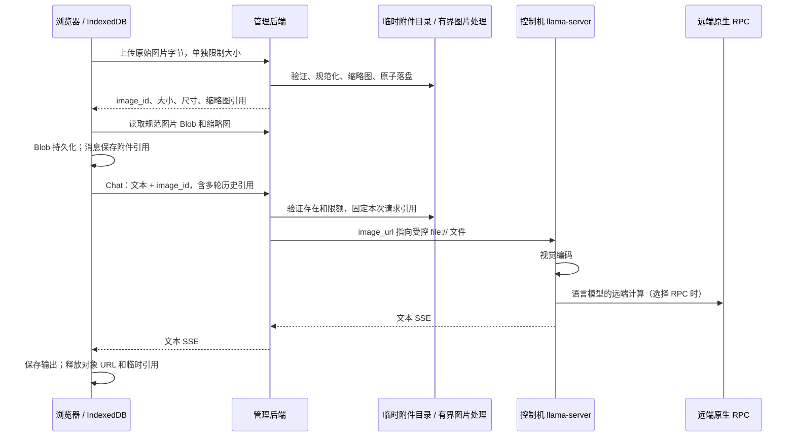

# llama.cpp Inference Manager：V3 Image 开发设计

- 版本：V3.0 / Image。
- 日期：2026-11-20（Asia/Shanghai）。
- 阶段：V3 Image 已实现；实际测试范围、证据和限制见 [V3 验证记录](validation_v3.md)。
- 代码基线：`891e60d`。延续 [V2 设计](development_v2.md)、[V2 验证记录](validation_v2.md) 和 [API](api.md)。
- 开发与验收使用独立临时目录和测试服务；正式管理后台保持停止，不搬动现有模型文件。
- 内存口径修订：1 GiB 仅约束管理后台和辅助进程，不统计浏览器；llama-server / RPC 推理内存继续单列。

## 1. 目标和范围

V3 跑通“识别模型包 → 创建图文实例 → 浏览器上传图片 → 后端转发 → llama-server 理解图片 → 流式回答 → 保存并恢复图文历史”的完整链路。模型扫描从“一个 GGUF 是一个模型”改为“一个独立目录是一个模型包”，为后续其他格式增加检测器和运行时适配器留下接口。

| 项目 | V3 要求 |
| --- | --- |
| 模型布局 | 每个逻辑模型独占目录，主权重、投影文件、分片和描述文件在同一包内 |
| 自动识别 | 分别识别文件格式、模型架构、输入 / 输出类型、资产角色及当前运行时支持情况 |
| GGUF | 支持纯文本包、图文包、同模型不同量化变体和完整的原生 GGUF 分片组 |
| 其他格式 | 可识别有依据的格式，如 Hugging Face safetensors 目录；本版展示为未支持运行，不加载这些权重 |
| 多模态创建 | 为支持图片的模型自动关联投影文件，显式选择变体和视觉编码设备 |
| 图片输入 | 本地文件选择、拖入、粘贴；单图、多图、仅图片消息，以及图文多轮对话 |
| 图片输出 | 不生成图片；模型输出仍为文本 / reasoning / SSE |
| 历史 | 图片随消息保存在当前浏览器，刷新、切换会话、停止生成后不丢失 |
| 多机 | 语言模型沿用 RPC Placement；视觉编码器首版在控制机 CPU 或显式选定的本机 GPU 上运行 |
| 运维 | 延续 V2 生命周期、SSH 信任、RPC 身份与占用保护，无远端管理 Agent |

本版不实现音频、视频、文生图、在线模型下载 / 转换、自动 GPU 调度、远端视觉编码器拆分，以及任意网络图片抓取。识别到其他模态应显示事实和支持边界，不能一律标成可用图文模型。

## 2. 当前实现需要改变的地方

| 现有模块 | 当前行为 | V3 变化 |
| --- | --- | --- |
| `services/model_catalog.py` | 递归将每个 GGUF 单独列出 | 包发现、文件角色分类、变体 / 分片组装、包状态与修订 |
| `services/gguf.py` | 读取有限元数据、拒绝 GGUF 分片 | 保持不读权重，补充模态 / 投影 / 分片元数据和完整性检查 |
| `schemas/instance.py` / 创建表单 | 单一 model_id，仅文本参数 | 包内变体选择、图文模式和视觉设备配置 |
| `runtime/llama_cpp.py` | 只传 `-m`，不加载投影 | 生成受控 `--mmproj`、视觉设备、图片目录参数；核验实际能力 |
| `schemas/instance.py` / Gateway | `content` 只能是字符串 | 兼容字符串并增加图文内容数组；附件引用转原生消息 |
| `core/http_limits.py` | 所有请求共用 2 MiB 上限 | 图片原始上传单独限额和流式计数，Chat JSON 保留小上限 |
| `Chat.tsx` / `sse.ts` | 仅文本历史和发送 | 上传状态、图片消息、附件恢复、模态兼容检查 |
| IndexedDB | sessions / messages，文本内容 | 可迁移的附件表，Blob 与消息引用分离 |

`Gateway` 继续使用共享 HTTP 客户端、流式响应和断连取消。管理端不执行视觉模型推理，不把编码器加载进 FastAPI。

## 3. 模型目录约定

### 3.1 一个目录对应一个模型包

`models.directories` 继续表示允许扫描的根目录。每个根目录的直接子目录是一个包；包内允许有限深度的资产子目录，不把同一个包的子目录再次识别为另一个模型。

```text
models/
  text-model/
    model-Q4_K_M.gguf
  vision-model/
    model-Q4_K_M.gguf
    mmproj-F16.gguf
  vision-model-with-variants/
    weights/
      model-Q4_K_M.gguf
      model-Q8_0.gguf
    projector/
      mmproj-F16.gguf
    model.json                    # 可选；普通无歧义目录无需填写
  sharded-model/
    model-Q4_K_M-00001-of-00002.gguf
    model-Q4_K_M-00002-of-00002.gguf
  future-hf-model/
    config.json
    model.safetensors
    tokenizer.json
```

同一个包的多个量化文件属于同一逻辑模型的不同变体；创建实例时只选择其中一个。两个不相关的模型应放在两个目录。GGUF 投影文件不单列为可创建实例的主模型。

V3 不再把根目录中散放的 GGUF 作为新模型入口，扫描结果给出 `legacy_layout` 及整理提示。不能悄悄漏掉旧文件，也不能自动移动文件。已运行实例不因扫描结果变化而被停止。

### 3.2 目录与资产身份

- `package_id`：允许根目录的规范标识与包相对目录生成的稳定 ID；内容更新不换 ID，跨目录移动 / 重命名产生新 ID。
- `variant_id`：包内逻辑主权重入口，分片组只生成一个 variant；不使用文件大小或当前 PID 当业务 ID。
- `asset_id`：包内相对路径对应的资产引用，角色为 `weights`、`projector`、`config`、`tokenizer` 或 `auxiliary`。
- `revision`：本次包清单与资产指纹形成的修订；实例记录启动时选定资产和修订快照。

公开 API 仅返回 ID、包内相对路径、格式及有限元数据。真实绝对路径、文件系统指纹留在后端。默认指纹沿用 stat / 有界头部信息，不声称完成了整个权重文件的密码学完整性校验，不在每次扫描时对数十 GiB 权重求完整 SHA256。

允许目录内链接只能解析到同一模型包内部，跨包或跨允许根目录的链接不用于自动配对。拒绝路径逃逸、循环链接；多个根目录有重叠时显式报告配置问题，不能重复展示同一包。

### 3.3 自动类型识别

识别结果分开存储，避免将“格式是 GGUF”误当成“能够看图”：

```typescript
interface ModelPackage {
  id: string;
  name: string;
  relative_directory: string;
  format: 'gguf' | 'hf_safetensors' | 'unknown';
  architecture: string | null;
  kind: 'text' | 'image_text' | 'other' | 'unknown';
  input_modalities: string[];
  output_modalities: string[];
  runtime_support: 'candidate' | 'unsupported' | 'unknown';
  availability: 'available' | 'copying' | 'incomplete' | 'needs_selection'
    | 'unsupported' | 'invalid';
  revision: string;
  variants: ModelVariant[];
  projectors: ModelAsset[];
  detection: { source: string; reasons: string[]; verified: boolean };
}
```

检测顺序：文件签名 / 有界元数据 → 已知架构和资产角色规则 → 包内关联 → 可选显式描述文件 → 固定运行时的能力检查。文件名只作为辅助线索，不单凭 `VL`、`vision`、`mmproj` 字符串宣布支持图片。

对 GGUF 读取 `general.architecture`、名称、量化、分片信息及固定版本使用的视觉 / projector 元数据。元数据读取键和架构映射由版本化检测器维护，保留解析预算，不能无限保留 tensor / tokenizer 数组。

自动配对规则：

1. 一个有效主权重入口和一个有视觉依据的投影文件，且架构 / 可获得的维度信息没有冲突，可形成图文候选；最终匹配在实际启动时验证。
2. 多个同模型量化变体可以共用同一投影，不要求 Q4 主权重必须配 Q4 投影。
3. 已知需要视觉投影但缺失时显示 `incomplete`；有多个无法唯一对应的投影或不同模型混放时显示 `needs_selection`，禁止猜第一个。
4. 仅有投影文件、投影为音频专用、主权重类型未知时，不形成可用图片实例。
5. 没有足够证据区分纯文本与缺失视觉资产时显示 `unknown`，说明缺少的信息；不能把所有 GGUF 无条件当成已识别纯文本。
6. `config.json` + safetensors 等其他格式使用轻量检测器标注格式和有依据的类型；不 import Transformers、不反序列化 pickle、不执行模型目录中的 Python。没有运行时适配器就不能创建。

`candidate` / `verified:false` 表示扫描阶段的候选判断。只有实际实例加载并通过图像能力探测后，才能标记该实例支持图片；不能将目录结构检查当成模型已验证。

### 3.4 可选描述文件与分片

普通目录自动识别；歧义目录可使用有大小上限、严格 schema 的 `model.json`：

```json
{
  "schema_version": 1,
  "name": "My Vision Model",
  "format": "gguf",
  "variants": [
    {"name": "Q4_K_M", "entry": "weights/model-Q4_K_M.gguf",
     "projector": "projector/mmproj-F16.gguf"}
  ]
}
```

文件仅表达包内资产关系，不接受 Shell、启动命令、环境变量、远程 URL、任意绝对路径或“跳过校验”。描述文件不能把元数据明确不兼容的组合强行标成可用。单一候选可自动默认；多个变体没有明确默认时由用户选择。

GGUF 分片按原生分片元数据与命名规则分组，核对数量、编号、架构和每片张量完整性；缺片、重复编号、不同组混杂均不可启动。只将第一片作为原生 `-m` 入口，不将各片当独立模型，不把分片合并进 Python 内存。分片投影若固定运行时不支持，应显示限制而非套用主权重规则。

### 3.5 扫描与变化处理

沿用文件监听和周期扫描兜底。包内所有必需资产至少经过两次稳定观察，再检查结构及完整性；一片稳定不代表整个模型包复制完成。逐包解析在有界工作线程执行，缓存未变的解析结果，不加载权重，不执行逐文件常驻任务。

默认包内资产深度最多 3 层，最多 1024 个相关文件；JSON 描述 / 配置单文件最多 1 MiB。超限显式报告，避免遍历缓存、`.git`、下载临时文件和任意大型目录。删除、原子替换、文件权限变化均更新包状态。

创建前以及 RPC 准备完成、进程启动前，重新核对已选主权重、全部分片、投影和描述修订。变化返回 `model_changed`，不混用两次扫描的资产。已经运行的实例继续使用启动快照，不因目录刷新而改绑资产。

## 4. 多模态实例创建

### 4.1 表单和请求

模型目录按包展示“GGUF / 其他格式”“文本 / 图文 / 未识别”、变体数量、总大小和检测原因。创建时选择包，再选择可用变体；有唯一兼容投影时自动带出，不要求用户手填路径。

```json
{
  "name": "Vision chat",
  "node_id": "local",
  "model_id": "package-id",
  "config": {
    "variant_id": "variant-id",
    "model_revision": "revision-at-selection",
    "modality": "image_text",
    "vision_device_id": "cpu",
    "context_size": 4096,
    "parallel": 1,
    "batch_size": 512,
    "ubatch_size": 128,
    "n_gpu_layers": 99,
    "placement": {"mode": "rpc", "devices": []}
  }
}
```

示例省略其余沿用字段；RPC 的 devices 实际提交必须非空并遵循 V2 校验。`variant_id` 在只有一个合法候选时可省略。多模态包默认 `image_text`；若显式选择“仅文本”，必须在创建结果中标明未加载视觉投影。

`vision_device_id` 首版为 `cpu` 或已核验的本机设备 ID，不接收 `RPC0`、任意地址和原生命令片段。默认 CPU，确保不会因 RPC 枚举顺序把视觉编码器隐式放到第一台远端；CPU 模式的性能成本在界面说明。用户选择本机 GPU 时检查可用设备、已选 Placement 和设备占用，模型内存包含投影与图像计算开销。

### 4.2 启动与能力核验

后端通过包解析结果构造参数数组：

- 文本：主权重入口及现有参数；不加载投影。
- 图文：增加 `--mmproj <已选投影绝对路径>` 和 `--media-path <受控图片目录>`。
- CPU 视觉编码：显式 `--no-mmproj-offload`。
- 本机 GPU 视觉编码：显式开启 offload 并设置 `--mmproj-device <解析出的本机设备名>`；不依赖原生默认设备选择。
- 语言部分继续生成现有 `--rpc`、`--device`、`--split-mode layer`、`--tensor-split`；不将模型或投影经 SSH 部署到远端。

所有参数必须在固定提交的实际二进制中核对。当前基线为 llama.cpp `9214bdb554544c35e4a9e2c2e8b75d8cfee330ab`；不跟随 master 自动升级，不因 Image 默认更换 RPC 发布包。

`/health` 正常后，适配器再查询原生能力字段。当前源码可通过 `/props` 的 `modalities.vision` 判断视觉输入；实现必须以固定构建的实际响应为准，不能只看笼统 `multimodal` 标签。要求图文但视觉能力未加载时，实例进入 failed、保留错误并释放资源，不能悄悄按纯文本 ready。

Instance 新增 capabilities 和已解析资产快照，至少包含 `input_modalities`、`output_modalities`、`image_input`、投影 ID、视觉设备及运行时版本。截图 / 文件名不参与能力推断。

图片占用上下文 token，数量与分辨率、模型架构相关；不能按文件 MiB 换算。界面说明与 Context size / Parallel 的关系。图像模型可能要求更大的 micro batch 或特定 Flash Attention 组合；适配器根据已验证规则给出限制，失败应指出具体参数，不能套用纯文本成功即图文成功的判断。

实现修订：图文实例增加 `image_max_tokens`（默认 1024，范围 64～4096），显式传入固定运行时的 `--image-max-tokens`，避免动态分辨率视觉模型使用过大的默认工作缓冲。该参数只在模型支持时约束视觉 token，不保证所有模型按相同方式缩放；提高上限需同时核对原生推理内存和上下文容量。

### 4.3 多机和生命周期

首版完成“控制机视觉编码 + 单机语言模型”和“控制机视觉编码 + RPC 语言模型”两种链路。远端继续只提供原生 ggml 计算设备，无需接收浏览器上传或运行图片 HTTP 服务。视觉编码器远端 offload、跨机器拆分不作为 V3 完成条件。

同一 GPU 通过多个 RPC 暴露时仍只允许一个受管实例占用。普通停止 / 删除 RPC 不绕过占用；图文创建失败、取消、销毁和后端退出均沿用资源释放与隔离机制。

管理后端退出 / 崩溃时，全部受管 llama-server 和临时图片处理子进程由原有 cgroup 清理。远端 RPC 保持待命，断连后释放对应实例资源；不增加远端 Agent、租约或断网限时回收承诺。

已销毁 / 已停止实例继续不出现在默认列表和节点实例计数，历史配置 / 日志和浏览器会话保留。

## 5. 图片端到端链路



### 5.1 上传、验证和预览

前端支持文件选择、拖拽、粘贴，入口均走同一上传流程。浏览器先检查文件字节数；不预先把原图转成 Base64，也不在验证尺寸前解码未知大图。上传中的附件显示占位、进度、取消 / 重试状态。

使用原始二进制上传，避免为上传引入 multipart 常驻解析开销。后端按流写入私有临时文件并统计真实接收大小；未知 Content-Length、分块上传同样受限，断连 / 超限删除 `.part`。

文件扩展名、请求 MIME 不能替代真实格式验证。首版接收静态 JPEG、PNG、WebP；拒绝 SVG、动图、多帧、音视频及其他格式。图片验证与规范化可使用一个轻量的 Pillow 依赖，不引入模型框架；在单个按需启动的有界子进程中完成，设置时间 / 地址空间限制，结束后退出，不保留大型解码分配。

先检查真实尺寸和像素数再解码，应用 EXIF 方向、移除 EXIF / 其他无关元数据，并生成规范 JPEG / PNG 与缩略图。原图不在控制端长期保存。页面明确展示送入模型的是规范化图片及其尺寸；不静默裁掉图片内容。

返回附件 ID 和元数据；前端读取规范图片 Blob 存入 IndexedDB，再将消息视为可发送。历史常驻展示缩略图，查看大图时才读取一张规范图片，退出后释放对象 URL，避免所有历史图片同时解码。

### 5.2 图文消息协议

保留原有字符串 `content`。图文请求增加严格区分的内容数组，图片仅通过平台上传得到的 ID 引用：

```json
{
  "messages": [
    {"role": "user", "content": [
      {"type": "text", "text": "比较这两张图片"},
      {"type": "image", "image_id": "image-uuid-1"},
      {"type": "image", "image_id": "image-uuid-2"}
    ]}
  ],
  "stream": true
}
```

这是管理端 API 的附件引用格式，不声称与完整 OpenAI API 完全相同。图片 part 只允许在 user 消息中；system / assistant 继续为文本。仅图片消息合法，数组顺序必须保持，前端发送判断改为“有文字或有已完成附件”，不能继续强制非空文本。

网关完成能力、历史图片总量和文件有效性检查后，将 image part 转为原生 `image_url`。原生请求示例为 `{"type":"image_url","image_url":{"url":"file://<内部文件名>.png"}}`。文件名只能来自附件仓库映射，`--media-path` 指向固定的私有图片目录；用户不能提交路径、`file://`、HTTP URL、data URI 或任意 Base64 绕过附件验证。

多图消息在各图片前插入固定位置标记 `First image` / `Second image` 等，帮助运行时区分相邻图片；不使用原始文件名，不重排用户文本和图片，不改变图像字节。标记按消息内顺序生成，历史重放时保持一致，不影响原生前缀身份稳定性。

该方式让原生 llama-server 读取同机文件，管理端不把每轮历史图片重新编码成大 JSON / Base64。客户端也不直接访问 llama-server。若固定构建的本地媒体读取不满足要求，应先解决适配器兼容并记录证据，不静默改成全量 Base64 转发。

### 5.3 图片持久化与重传

浏览器 IndexedDB 是会话和规范图片的长期保存位置，服务端图片目录是可回收的推理暂存。两者职责分开，不能仅保存短期 URL 导致第二天历史图片失效。

- 新增 attachments 表存 Blob、缩略图、类型、尺寸、字节数、摘要和 session_id；消息保存 attachment ID / 有序内容引用，避免 Base64 混入文本字段。
- 升级旧文本消息时视为无附件，保留 sessions / messages 主键及原有排序和中断状态逻辑。
- 用户消息、附件引用、会话和 assistant 占位通过 IndexedDB 事务提交；配额不足则报告保存失败，不先开始生成。
- 发送完整历史时先确认所有引用的服务端附件存在；过期 / 后端缓存清理后，从浏览器 Blob 重新上传，并更新暂存 ID 映射。原图预处理和规范图片恢复应区分入口，恢复时验证格式与摘要，不重复有损压缩。
- 规范图片恢复使用同一上传路由的明确 `representation=normalized` 模式，仍做真实性 / 尺寸 / 完整解码检查，不是跳过验证。一般上传默认为 original 模式。
- 服务端在 Chat 接受时原子校验并固定引用，直到请求结束才释放；清理不能删除正在被 llama-server 使用的图片。
- 明确的 `410 media_expired` 且尚未调用上游时，前端可恢复附件并重提一次；已经开始 SSE 或其他不明确失败不自动重放推理。
- 图片消息生成失败 / 停止不删除用户图片；删除会话同时删除其 Blob 和消息，不影响其他会话。
- 切换为不支持图片的实例时，若历史含图片，阻止图文发送并说明原因。不能静默删掉图片只传文字；可新建文本会话。

浏览器存储被手动清空且服务端暂存也过期后，无法恢复图片，必须提示“附件已丢失，请重新添加”，不能宣称永久云端保存。

### 5.4 清理与边界

服务端附件位于 `data/media/images/`，临时文件在独立 staging 目录，目录 0700、文件 0600；该目录加入 Git 忽略。存储记录以不可预测的 ID 关联生成的文件名，不以用户文件名构造路径。

缓存目录使用 controller_id 归属标记和排他锁；拒绝已有不明文件或其他控制端目录。GC 仅清理符合平台生成规则的文件名，不删除目录内其他文件。

下载通过受控 FileResponse 返回已验证图片，缩略图独立提供；设置实际 Content-Type 和 `nosniff`，不挂载整个 data 目录。保持现有同源修改限制；V3 沿用可信本机、无账户系统的部署边界，不宣称新增用户间隔离。

定期清理过期且未被请求固定的附件，失败上传、处理超时和取消立即回收临时文件。重启时删除本平台孤立 staging 文件，并在确认原受管推理进程已退出后恢复清理。配额不足时返回可读错误，不能为腾空间删除任意会话文件或模型。

### 5.5 缓存分层与传输选择

V3 保持“二进制上传 + 附件 ID + 受控本地文件引用”。Base64 是字节的可逆编码，不增加图像信息，也不天然提高视觉缓存命中率。同一份文件经 Base64 解码或本地读取后，字节相同才有相同的内容身份；缩放、重新压缩和预处理配置变化才可能改变图像效果与缓存键。

| 层次 | 缓存对象与身份 | V3 处理 |
| --- | --- | --- |
| 浏览器历史 | 原消息引用和规范图片 Blob | 保证刷新后可见、服务端过期后可恢复，不作为模型计算缓存 |
| 文件缓存 | 已验证的规范图片，按实际文件 SHA256 去重 | 多个附件记录可引用同一不可变文件，避免重复存储；不信任客户端自报摘要 |
| 预处理缓存 | 原始上传 SHA256 + 规范化配置 / 处理器版本 → 规范图片和缩略图 | 同一上传可复用已有验证结果与派生文件，不每轮重新压缩；首次仍按流计算摘要和验证 |
| 视觉特征缓存 | 图像特征 / embedding | 后续运行时扩展点，不在管理后端保存张量；V3 不承诺跨请求 / 跨会话免编码 |
| Prompt / KV 缓存 | 已计算的完整上下文前缀、媒体块身份和槽位状态 | 在固定运行时允许时利用并测量命中；与文件缓存分开报告 |

规范图片一旦生成即保持字节不可变，转发不再次进行有损压缩。同一图片的暂存 ID / URL 改变，不应触发重新生成规范文件；源文件变化、处理器版本或尺寸 / 质量策略变化则生成新缓存项。内容哈希和用户附件 ID 分开，便于保留会话生命周期和文件去重；GC 只有在所有附件引用和活动请求均释放后才可删除共享文件。

文件缓存命中只保证少传 / 少存 / 少做预处理，不代表跳过图像解码或视觉编码。不同会话、不同提示前缀、不同实例和被淘汰的槽位不能保证复用既有 KV。后续若增加视觉特征缓存，其键必须包含实际模型 / 投影版本、图片内容、视觉预处理与编码配置，不能只用文件名或 image_id，也不能跨模型误用。

固定源码的 `mtmd-helper.cpp` 对传入媒体字节生成 SHA256；`server_tokens` 将媒体身份纳入前缀比较。`cache_prompt` 的公共前缀复用与 `--cache-reuse` 的 KV shifting 是两种机制：当前源码加载多模态投影时禁用后者，不能据此宣称所有前缀缓存都不可用，也不能把开了参数当成缓存生效。

验收增加：相同字节经文件 / Base64 两种原生输入得到一致媒体身份的隔离对照、重复上传 / 规范化命中、同会话同前缀续问、改图 / 改前缀失效、实例重启和槽位切换后回退重算。产品链路仍使用文件引用，Base64 仅作原生兼容性对照。分别记录上传 / 预处理命中、可观测的 cached prompt token、视觉阶段耗时与首 token 延迟；不能用文件命中数字替代视觉编码命中。

## 6. API 与数据变化

沿用 `/api/v1` 前缀，不以产品 V3 直接更换 API 路径。

| 方法 | 路径 | V3 行为 |
| --- | --- | --- |
| GET | `/models` | 一包一条；返回格式、模态、变体、可用状态、修订和检测原因 |
| GET | `/models/{id}` | 包详情及资产关系；旧 ID 通过明确映射兼容，不当作另一个新包重复展示 |
| POST | `/models/refresh` | 异步刷新包扫描，沿用现有行为 |
| POST | `/instances` | 增加变体 / 修订 / modality / vision_device_id，仍异步启动 |
| GET | `/instances`、`/instances/{id}` | 增加资产快照、实际输入能力和视觉设备；默认不返回 stopped 历史 |
| POST | `/media/images` | 原始二进制；`representation=original` 默认，或明确 normalized 恢复模式；201 返回附件元数据 |
| GET | `/media/images/{id}` | 附件状态和元数据，过期返回 410，未知 ID 返回 404 |
| GET | `/media/images/{id}/content` | 流式读取规范图片 Blob |
| GET | `/media/images/{id}/thumbnail` | 小缩略图；不对外提供原始文件路径 |
| DELETE | `/media/images/{id}` | 删除未使用暂存附件；请求固定期间返回 409，幂等处理已删除记录 |
| POST | `/instances/{id}/chat/completions` | 字符串 / 图文数组输入；文本 JSON 和 SSE 输出保持兼容 |

媒体响应至少包含 id、mime_type、size_bytes、width、height、sha256、expires_at、content_url、thumbnail_url，以及是否发生缩放。摘要基于规范文件字节，不是模型权重摘要。

错误沿用 `detail:{code,message}`，新增明确区分：`model_layout_invalid`、`model_incomplete`、`model_selection_required`、`model_changed`、`format_unsupported`、`projector_mismatch`、`vision_not_loaded`、`image_input_unsupported`、`image_invalid`、`image_too_large`、`image_count_exceeded`、`media_expired`、`media_storage_full`。

请求字节超限用 413，格式 / 图片结构不合法用 422，占用 / 配置变化用 409，暂存过期用 410，处理队列满用 429；上游网络错误用 502，视觉加载失败保留到实例错误。原生输入错误应转换为可定位的参数 / 图片错误，不能一律报成管理网关故障。SSE 开始后保留既有流式错误与中断保存约定。

不在日志、数据库错误字段或任务进度中记录 Base64、完整图片、完整聊天正文及不受限的原始异常。记录附件 ID、尺寸、阶段和受限错误即可。

## 7. 轻量化与默认预算

本节默认限制已实现；内存实测采用后台与辅助进程口径，结果及工作负载见 [验证记录](validation_v3.md)。

| 项目 | 默认上限 / 策略 |
| --- | --- |
| Chat JSON | 保持 2 MiB，含文本和附件引用，不含图片二进制 |
| 单次原图上传 | 8 MiB；Content-Length 和实际流量双检查 |
| 原图像素 | 最大 1600 万像素、单边 8192；必须先检查再解码 |
| 规范图片 | 最长边 2048、最多 4194304 像素、文件最多 4 MiB；超限无法规范化时拒绝 |
| 历史缩略图 | 最长边 320，单文件最多 128 KiB |
| 每条消息 | 最多 4 张图片 |
| 单次推理完整历史 | 最多 8 张图片、规范文件合计最多 16 MiB；按出现次数计数，不只按不同 ID |
| 上传 / 预处理 | 同时最多 2 个上传，图片处理子进程最多 1 个；不建立无限等待队列 |
| 图片子进程 | 墙钟 10 秒、CPU 5 秒、地址空间 384 MiB；Linux 上核验限制效果 |
| 图片推理 | 管理端同时最多 1 路含图片请求；仍计入原有全局 Chat 并发上限 |
| 附件暂存 | 合计 512 MiB，最多 4096 条记录，包含进行中的上传预留和临时文件；默认闲置 24 小时过期 |
| 浏览器附件磁盘存储 | IndexedDB 默认 256 MiB 预算，同时服从浏览器实际剩余配额；不是后台 RAM 指标；超限要求整理，不静默删除历史 |
| 图片读取 | 分块上传 / 下载；只显示可见缩略图，大图按需打开；关闭后释放对象 URL |

同一图片在多个历史消息中出现仍可能重复产生视觉 token，不能因为磁盘摘要去重就绕过推理限额。历史超限时要求新建会话或用户明确调整发送范围，保留原始历史，不自动丢图。

仅对精确的图片上传路由放宽请求上限，按真实字节流限制；不能全局取消 RequestLimits。预处理子进程、队列、文件 IO 均需要取消和超时，不能阻塞 FastAPI 事件循环。

管理后端、launcher、SSH 和临时图片处理等辅助进程的合计 RSS 需低于 **1 GiB**，浏览器内存不计入。llama-server 和远端 RPC 的权重、视觉编码器、图像张量、KV / prompt / 计算缓存单列；管理后台不额外常驻一份视觉张量缓存。Jetson 共享物理内存仍需看整机 RAM / swap，不因统计分列而忽略容量约束。V2 历史报告采用含专用浏览器的旧口径，保留原始结果，不直接拿旧合计数字当成 V3 后台占用。

不增加常驻 Node、数据库服务或图片处理守护进程。Pillow 如被采用，必须纳入锁文件、许可证及增量内存测量。元数据扫描不依赖 Torch、Transformers、完整 tokenizer 加载和模型 Python 代码。

## 8. 兼容与迁移

### 8.1 模型布局和旧标识

V3 要求新建模型使用独立包目录。现有 `models/*.gguf` 和嵌套散放文件先生成整理清单：建议包目录、主权重组、投影候选、冲突与无法确定项。默认只预览，不自动搬动、删除、重命名或跨文件系统复制大模型。

已有单模型子目录可直接识别；原模型 ID 与新 package / variant 的映射由原路径和已核验资产关系建立并持久化。重排文件需要单独的显式迁移操作；只有唯一映射才能自动记录，歧义需要选择，不能根据相似名称合并。

旧实例保留 model_id、模型名和原始启动快照，历史记录可继续查看。`GET /models` 只列新包，不把旧别名再列一遍；旧 ID 查询可解析到映射的指定变体。未整理的裸文件显示迁移原因，不能通过旧 ID 绕过独立目录要求新建。

旧文本请求缺少 variant / modality 时，仅在解析唯一时按文本方式兼容；旧请求不能因为目录新增投影就自动变成额外加载视觉编码器的实例。运行中实例、已有 worker、SSH 凭据和主机信任均不被迁移过程修改。

### 8.2 持久化

SQLite 从 schema 2 升至 3 前备份到独立 `.pre-v3.bak`，事务迁移，失败不改变原库。增加模型 ID / 变体别名记录和临时附件元数据；目录扫描主体仍可重建，不把权重内容放入 SQLite。新版本拒绝由旧程序直接解释，回退使用匹配备份和保留的模型目录。

IndexedDB 从 version 1 升级到 version 2，增加 attachments 表和消息内容引用。迁移不得清空旧 sessions / messages，旧文本显示、reasoning、刷新中断恢复和会话删除继续兼容；多标签升级阻塞要有提示，不能无限等待。

本轮已实现迁移并在隔离数据库及浏览器中验证；未启动正式后台升级用户数据库，也未执行用户模型文件整理。首次正式启动前应按预览计划核对目录布局。

## 9. 模块与实施顺序

| 阶段 | 工作 | 退出条件 |
| --- | --- | --- |
| M1：模型包目录 | 格式检测器、GGUF 元数据、变体 / 分片组、模型 API、旧 ID 映射和迁移预览 | 文本包 / 图文包正确归类，mmproj 不再被当主模型；无歧义目录零配置发现 |
| M2：图文实例 | 创建表单、资产绑定、受控启动参数、视觉设备与实际能力核验 | 原生单机图文实例 ready，错误投影明确失败；文本 / RPC 创建不回归 |
| M3：图片网关 | 附件仓库、流式限额、按需图片处理、图文 schema、file:// 适配 | API 真正向原生 llama-server 发送图像并取得回答；取消 / 错误可回收 |
| M4：浏览器闭环 | 上传 / 拖拽 / 粘贴、缩略图、多图消息、Blob 历史、刷新 / 过期恢复 | 从 UI 到真实模型的单图、多图、多轮和重传全程通过 |
| M5：多机与预算 | 控制机视觉 + RPC 语言模型、生命周期、性能 / 内存回归 | 固定运行时和真实机器证据齐全，控制层预算通过，保留未验收边界 |

建议新增包检测器 / 资产解析模块、媒体仓库 / 图片处理模块和前端附件组件；扩展现有 catalog、adapter、Gateway、Chat / IndexedDB，而不是另起第二个管理后端。后续格式通过 Detector / Runtime Adapter 接口注册，不把所有格式塞入 GGUF 判断分支。

每个阶段交付可评审改动和对应证据；不得只增加图片按钮或 `--mmproj` 参数便宣布前后端图片链路完成。

## 10. 验收与完成标准

### 10.1 自动化与隔离场景

| 场景 | 必须验证 |
| --- | --- |
| 普通目录 | 一个文本包一条记录；一个主权重 + 一个投影自动识别图文；目录名不参与强制判定 |
| 变体 / 分片 | 变体不重复成包；分片完整可解析，缺片 / 重复 / 混组不可创建 |
| 投影 | 孤立、缺失、多个候选、音频专用、架构冲突有明确状态；无证据不猜配对 |
| 其他格式 | 有依据识别 safetensors 目录，未支持运行明确显示，不执行目录代码 |
| 文件变化 | 复制 / 截断 / 原子替换 / 链接越界 / 包重命名 / 大目录解析限额；活动实例不被扫描停止 |
| 实例 | 正确生成 CPU / 本机 GPU 视觉参数；加载不兼容或缺少实际图像能力不能 ready |
| 上传 | MIME 冒充、截断、像素炸弹、动图、超大 / 分块上传、处理超时、取消与队列满 |
| 图片引用 | 未知 / 过期 ID、任意 URL / 路径拒绝；总量按完整历史统计；使用中附件不能被 GC 删除 |
| Gateway | 图片顺序和历史保留、仅图片输入、非流式 / SSE、断连、上游解码错误和并发限额 |
| IndexedDB | 旧文本数据升级不丢失，Blob 存储配额失败、会话删除、刷新恢复、失效缓存恢复 |
| 前端 | 图片入口一致、上传失败可重试、流式停止保留图片、切换文本实例不静默丢图、移动端无溢出 |
| 既有功能 | 纯文本 Chat、reasoning、SSH / RPC 自动发现 / 创建 / 删除与占用、stopped 列表过滤继续通过 |

自动化允许使用小型 GGUF / 图片样本和假运行时检验状态机，但假模型返回“看到了图片”不能作为视觉理解验收。测试临时服务使用独立数据库、目录、端口与身份记录，不启动或停止用户现有模型服务。

### 10.2 真实图片闭环

选择固定 llama.cpp 构建实际支持、来源和主权重 / 投影版本明确的小型图文模型，记录文件摘要、许可证、量化、配置和硬件。验收至少包括：

1. 页面扫描到包和视觉候选，用户创建实例，实际视觉能力为真。
2. 从前端发送两张视觉内容明显不同的图片，回答能够区分内容；提示和原始文件名不透露答案。
3. 多图比较、仅图片消息、第二轮询问上轮图片，确认完整图文历史实际送达模型。
4. 刷新页面 / 切换会话后图片可见并能续问；主动使服务端暂存过期，浏览器 Blob 恢复后仍可推理。
5. 停止生成、请求取消、销毁实例、管理后端正常退出及 SIGKILL 后没有受管模型 / 图片处理进程遗留，远端 RPC 按 V2 待命。
6. 完成控制机视觉编码 + 两远端 RPC 语言模型的真实图文流程，单独记录本机视觉 GPU 可选路径的实际验证范围。

未取得真实三机视觉结果时，必须标为“单机已验收、多机待验收”，不能用隔离 CPU RPC 或外部另行运行的模型代替本平台完整链路。

### 10.3 内存与稳定性

沿用 `scripts/check_memory.py` 的 RSS / USS / PSS 测量，确认新图片处理子进程也被纳入，不能只测 FastAPI。V3 验收只提供 `--pid <管理后端PID>`，不传 `--browser-pid`；launcher、SSH 和图片处理进程仍必须统计。至少 30 分钟，不强制 GC，覆盖模型扫描、上传高峰、预处理、图文流式、反复切换含图片历史、查看 / 关闭大图和清理。浏览器可以单独观测以排查体验问题，但不影响后台 1 GiB 门槛。

默认限额组合的全过程峰值必须低于 1 GiB；报告基线、增量和峰值，失败先降低默认并发 / 图像限额或修复常驻复制，再重新验收。同步记录 llama-server / RPC 内存、整机 RAM / swap、预处理延迟、首 token 延迟和实际视觉 token 消耗，避免只报告生成阶段的低占用。

阶段结束后新增 `validation_v3.md` 和可复测证据，区分已实现、隔离通过、真实单机、真实三机及未覆盖项。本文件的默认值和路线是设计要求，不是测试结果。

## 11. 参考与版本约束

- [llama.cpp 多模态组件说明](https://github.com/ggml-org/llama.cpp/blob/master/tools/mtmd/README.md)：主模型和投影资产职责；这里只借鉴其分离方式，不将上游全部模型列为本项目已支持。
- [llama-server 参数和消息说明](https://github.com/ggml-org/llama.cpp/blob/master/tools/server/README.md)：投影加载与设备、本地媒体、图文消息及能力字段。实施以固定提交的源码 / `--help` / 原生响应为准，不能仅照抄可变化的 master 文档。
- [RPC 说明](https://github.com/ggml-org/llama.cpp/blob/master/tools/rpc/README.md)：复用既有计算设备通路；不据此保证视觉编码器可任意跨节点拆分。
- 缓存机制以固定源码 `tools/mtmd/mtmd-helper.cpp`、`tools/server/server-common.cpp` 和 `tools/server/server-context.cpp` 为核对依据：分别区分媒体身份、前缀匹配和多模态 KV shifting 限制，不将传输编码当作缓存协议。

上游能力不是本项目的内存、图片数量和兼容承诺。目录契约、附件存储、限额与迁移规则均为 V3 产品设计，需按上述步骤实现和验证。
